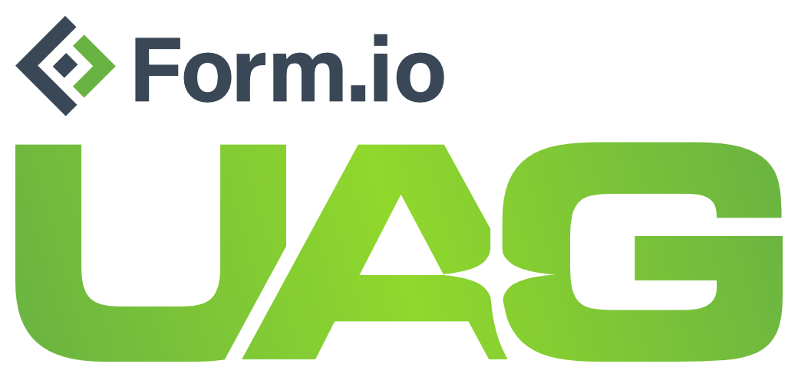
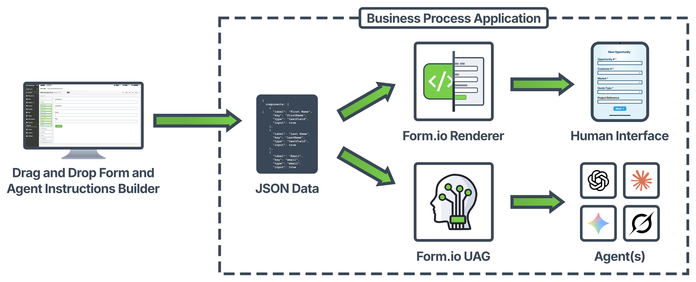
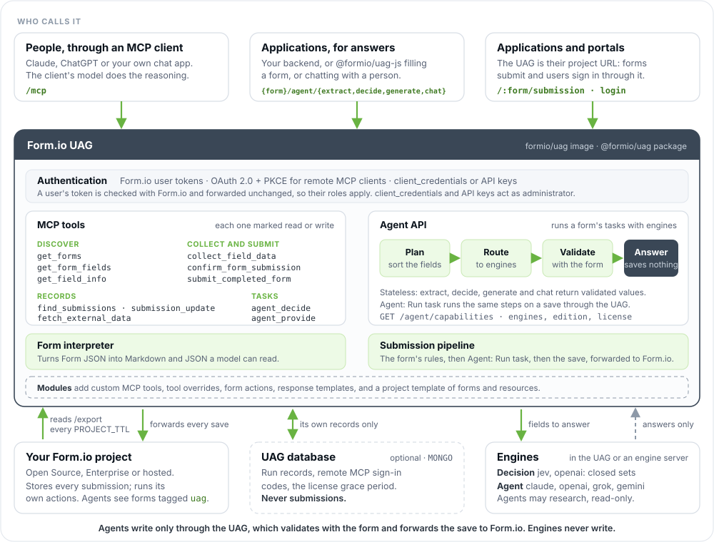
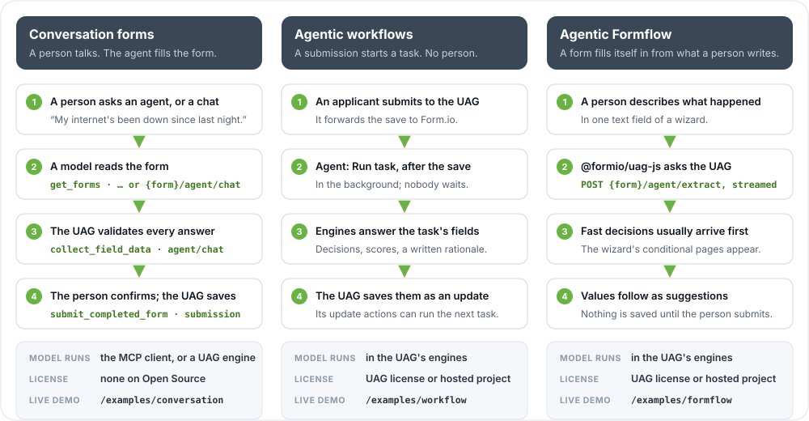
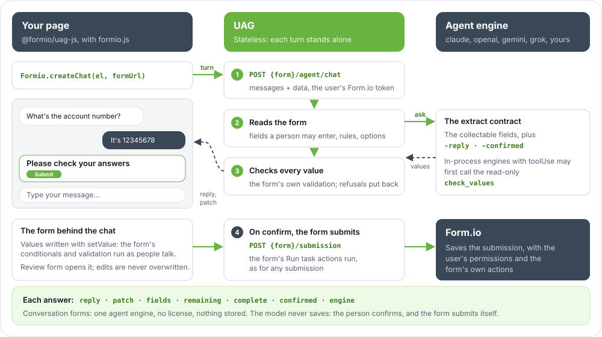
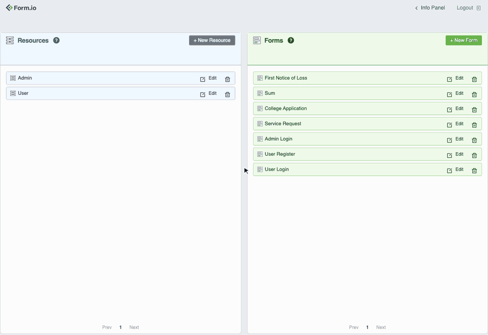
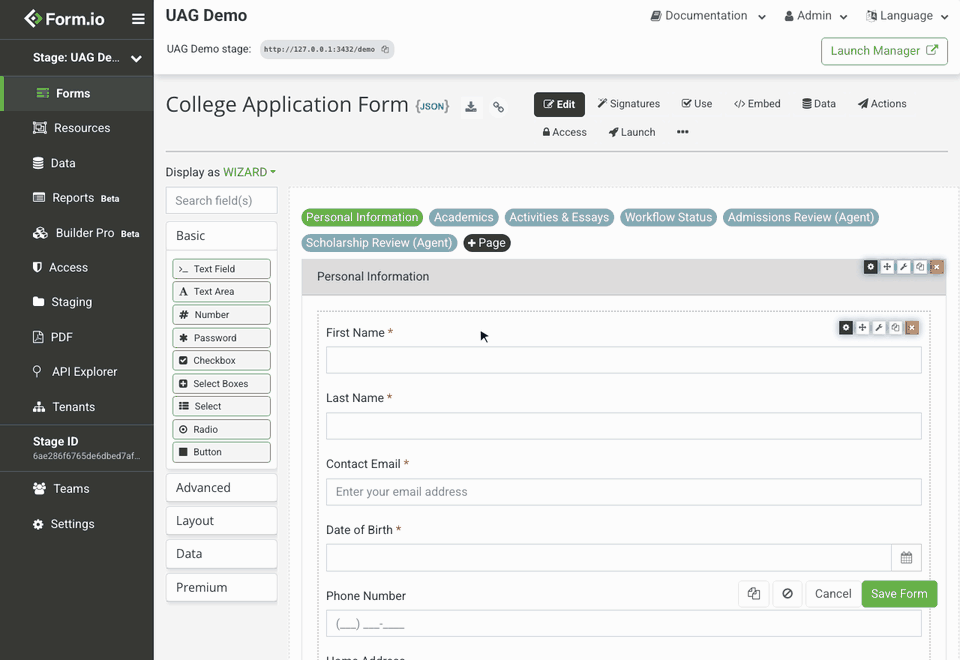
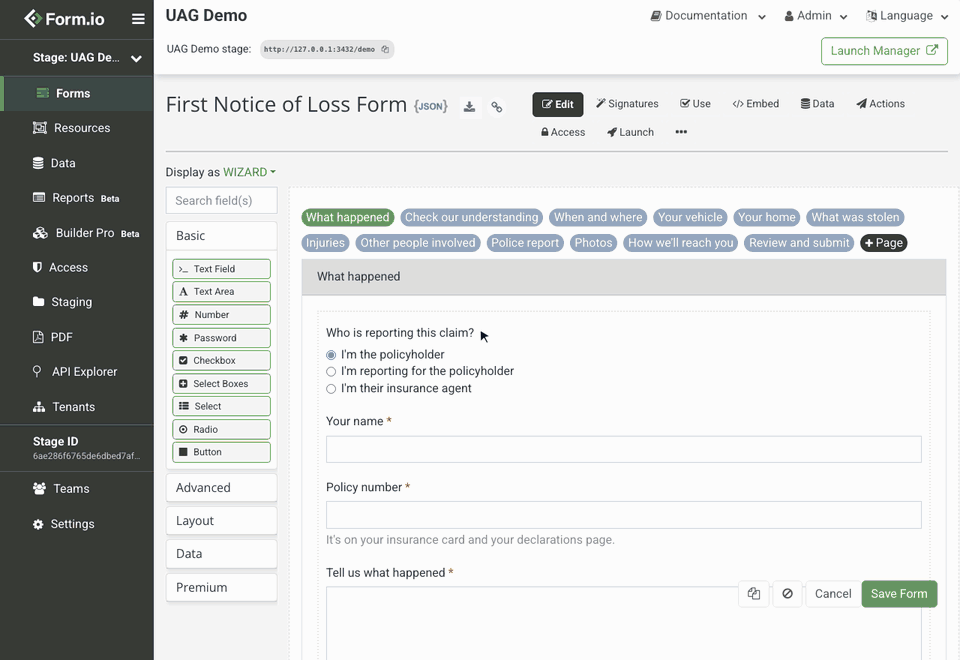
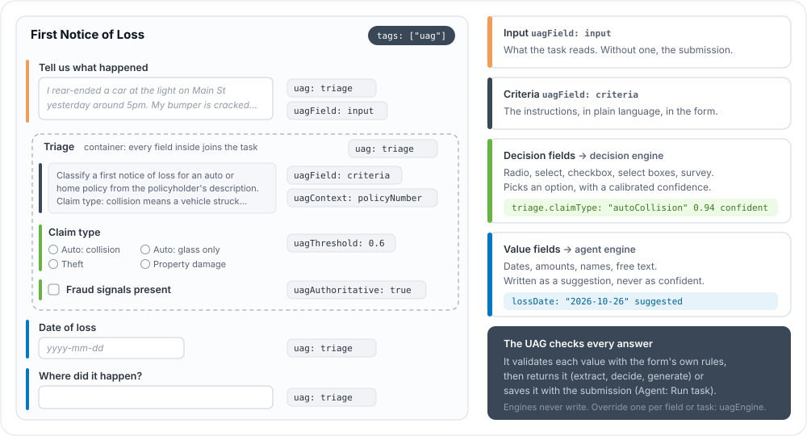
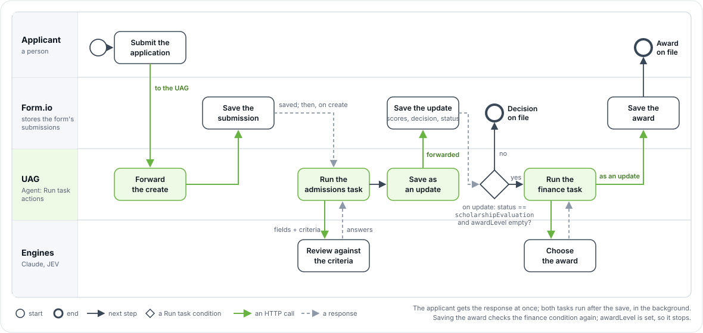

<p align="center">
  
</p>

<p align="center">
  <a href="https://www.npmjs.com/package/@formio/uag"></a>
  <a href="https://hub.docker.com/r/formio/uag"></a>
  <a href="https://registry.modelcontextprotocol.io/v0/servers?search=io.form/formio-uag"></a>
  <a href="./LICENSE.txt"></a>
</p>

<p align="center">
  <a href="https://ai.form.io/examples"><b>Live demos</b></a> ·
  <a href="https://ai.form.io/developers"><b>Developer docs</b></a> ·
  <a href="https://github.com/formio/ai"><b>Agentic Coding Plugin</b></a> ·
  <a href="#quickstart">Quickstart</a> ·
  <a href="#documentation">All documentation</a>
</p>

The **Universal Agent Gateway (UAG)** is a server that lets AI agents work with your [Form.io](https://form.io) forms. It does for an agent what the [JavaScript renderer](https://github.com/formio/formio.js) does for a person: it turns Form JSON into something the agent can understand. Then it validates what the agent sends back with the form's own rules, and saves it with the user's own permissions.

The form is the contract. Add a field and agents ask for it; rewrite a task's instructions and the next submission is handled differently. Nothing is redeployed, no prompt changes, no model is retrained.

**Build it with your coding agent.** The [Form.io Agentic Coding Plugin](https://github.com/formio/ai) gives Claude Code, Cursor, Codex and other coding agents a `formio-uag` skill that tags your forms, designs their tasks, deploys the UAG and wires your application to it. Install it in your application's folder with `npx skills add formio/ai`.



## How it works



- **It sits in front of one Form.io project.** At startup the UAG reads the project's `/export` and registers every form tagged `uag`. It re-reads it every `PROJECT_TTL` seconds (default 900). A form without the tag is invisible to agents.
- **It has three entry points.** `/mcp` serves [MCP](https://modelcontextprotocol.io) tools to agents that bring their own model. `{form}/agent/*`, the **Agent API**, runs a form's tasks inside the UAG with the model **engines** you enable, and saves nothing. The project's own API is served too, so an application can use the UAG's URL as its project URL.
- **It forwards every submission to Form.io.** Form.io saves it and runs the form's own actions (Save Submission, Webhook, Email, Login, Role, Group). The UAG runs only its own actions, such as **Agent: Run task**, so nothing runs twice.
- **Every call has a Form.io identity.** A Form.io user token (`x-jwt-token`) is verified with Form.io and forwarded unchanged. MCP clients sign in through OAuth 2.0 with PKCE (`MCP_OAUTH`), and their roles and permissions decide what the agent may read and write for them. Servers using `client_credentials` or an API key act as the project administrator.
- **Every write goes through the form.** An MCP client's model writes only through tools such as `submit_completed_form`. Engines only answer, and are never given a write tool. The UAG validates every value with the form before it forwards the write.


The UAG is built on Form.io's core logic. Every value an agent sends runs through the [`@formio/core`](https://github.com/formio/core) processors, the same validation, conditional and calculation rules Form.io itself applies, so the data it saves is valid and deterministic. More detail: [How the UAG works](https://ai.form.io/developers).

## Three ways to use it



### Conversation forms

A person talks to Claude, ChatGPT or your own chat app, and the agent fills in a form for them. Build it with the [MCP tools](https://ai.form.io/developers/mcp-tools) or [Connect Claude](https://ai.form.io/developers/connect-claude), or embed a form as a chat in your own page with the [chat widget](https://ai.form.io/developers/chat): `Formio.createChat(element, formUrl)` from [`@formio/uag-js`](./packages/uag-js), with the UAG as the only backend. [Try it](https://ai.form.io/examples/conversation) · [source](./demo/public/apps/conversation/chat.js) · [prompt for your coding agent](https://github.com/formio/ai/blob/main/examples/agents/service-chat.md).





### Agentic workflows

An application saves a submission through the UAG; an **Agent: Run task** action runs the form's task after the save and saves the result, which can start the next task. [Try it](https://ai.form.io/examples/workflow) · [source](./demo/server/workflow.mjs) · build it with [Workflows](https://ai.form.io/developers/workflows) · [prompt for your coding agent](https://github.com/formio/ai/blob/main/examples/agents/admissions-workflow.md).



### Agentic Formflow

A person describes what happened, and the form fills itself in: decisions choose the wizard's pages, extraction prefills the rest. [Try it](https://ai.form.io/examples/formflow) · [source](./demo/public/apps/formflow) · build it with the [Agent API](https://ai.form.io/developers/agent-api) and [`@formio/uag-js`](./packages/uag-js) · [prompt for your coding agent](https://github.com/formio/ai/blob/main/examples/agents/claim-formflow.md).



One deployment can serve all three. Conversation forms run on Form.io Open Source with no license; the other two need a license or a hosted project (see [License](#license)). The whole demo site, with its forms and a flow viewer that shows every call the agents make, is in [`demo/`](./demo); these recordings are made from it by [`demo/recordings`](./demo/recordings).

## Quickstart

Form.io Open Source and the UAG in one Compose stack. Replace every `CHANGEME`; `ADMIN_KEY` must match on both services.

```yaml
services:
  mongo:
    image: mongo:7
    volumes: [mongo-data:/data/db]

  formio:                         # Form.io Open Source, listening on 3001
    image: formio/formio
    depends_on: [mongo]
    ports: ["3000:3001"]
    environment:
      NODE_CONFIG: '{"mongo": "mongodb://mongo:27017/formio-oss", "jwt": {"secret": "CHANGEME"}, "mongoSecret": "CHANGEME"}'
      ROOT_EMAIL: admin@example.com
      ROOT_PASSWORD: CHANGEME
      ADMIN_KEY: CHANGEME
    healthcheck:
      test: ["CMD", "node", "-e", "fetch('http://localhost:3001/').then(r => process.exit(r.ok ? 0 : 1)).catch(() => process.exit(1))"]
      interval: 5s
      retries: 40

  formio-uag:
    image: formio/uag
    depends_on:
      formio: { condition: service_healthy }
    ports: ["3200:3200"]
    environment:
      PROJECT: http://formio:3001     # how the UAG reaches Form.io
      ADMIN_KEY: CHANGEME
      JWT_SECRET: CHANGEME
      LOGIN_FORM: http://localhost:3000/user/login
      PROJECT_TTL: 10                 # re-read the project every 10 s while you experiment

volumes:
  mongo-data:
```

```bash
docker compose up -d

# Get a token, then list the MCP tools.
TOKEN=$(curl -s -X POST http://localhost:3200/auth/token -H 'Content-Type: application/json' \
  -d '{"grant_type":"client_credentials","client_id":"formio-oss-x-admin-key","client_secret":"CHANGEME"}' \
  | node -pe 'JSON.parse(require("fs").readFileSync(0)).access_token')

curl -s -X POST http://localhost:3200/mcp -H "Authorization: Bearer $TOKEN" \
  -H 'Content-Type: application/json' -H 'Accept: application/json, text/event-stream' \
  -d '{"jsonrpc":"2.0","id":1,"method":"tools/list"}'
```

Then tag a form `uag` (in the portal, **Form Settings → Tags**) and connect an agent. The [Quickstart](https://ai.form.io/developers/quickstart) covers a hosted Form.io project, a first tool call and the Agent API, and [Connect Claude](https://ai.form.io/developers/connect-claude) connects Claude Desktop or claude.ai. Or have your coding agent do all of it with the [Agentic Coding Plugin](https://github.com/formio/ai).

### Run the whole demo locally

With Docker, a Form.io Enterprise license and a license that includes the UAG, one command runs the demo site with all three examples, Form.io Enterprise and its portal, and the UAG built from this checkout:

```bash
yarn install
yarn demo:start 3430    # the site on :3430, Form.io and its portal on :3431, the UAG on :3432
```

It creates the demo project and its forms itself, and prints where everything is and how to sign in to the portal. It reads `LICENSE_KEY` and your model keys from the root `.env`; the portal password and the other secrets come from there too when you set them, and are random otherwise. See [the demo's README](./demo/README.md#the-whole-demo-on-your-machine-self-hosted-yarn-demostart-port).

## Tasks

A **task** teaches an agent to fill part of a form, with instructions written in the form itself. It is defined entirely by custom properties on components (**API → Custom Properties** in the form builder), and a form can have several.



| Property | On | Meaning |
|---|---|---|
| `uag: <task>` | Any field, or a panel, container or fieldset | The field belongs to the task. On a container, every field inside it does too, except fields in data grids and edit grids. |
| `uagField: criteria` | A content component with `uag: <task>` | The task's instructions. Write them like a brief for a new employee, including the role the agent acts in, exact option values and formats. |
| `uagField: input` | A field with `uag: <task>` | The text the task reads. Without one, the task reads the submission, except its own fields; `{form}/agent/extract` then needs `text`. |
| `uagContext`, `uagTools` | The criteria component | Extra data paths sent to the engines; read-only MCP tools the agent may research with. |
| `uagEngine` | A task field, or the criteria component | Which engine answers that field, or the whole task. |
| `uagThreshold`, `uagAuthoritative`, … | A task field | How confident a decision must be; whether the server owns the value, so no client can set it. |

Every property, with its default: [Form properties](https://ai.form.io/developers/form-properties). How tasks, decision fields and value fields work: [Concepts](https://ai.form.io/developers/concepts).

> **No form, no error.** A form missing the `uag` tag simply is not there for agents, and a new tag or criteria edit reaches them after the next `PROJECT_TTL` refresh. Restart the UAG to pick changes up at once.

## Agentic workflows

A workflow is a task that the **Agent: Run task** action runs on a submission the UAG receives. The demo's college application runs two tasks, and the second is started by the first one's save:



To set one up on **Form.io Enterprise**:

1. **Connect a portal stage to the UAG.** Set `PORTAL_SECRET` on the UAG, then in the portal connect a stage to it as an on-premise environment. In that stage the portal lists the UAG's own actions next to Form.io's. See [Deployment → Connecting the Enterprise portal](https://ai.form.io/developers/deployment#connecting-the-enterprise-portal).
2. **Add "Agent: Run task" to the form.** Choose the **Task**, what to **Answer** (the whole task, or its decision fields only) and **When** (after the save, in the background, or before it, while the submitter waits), with Form.io's usual methods and conditions. Mark the fields the agent owns `uagAuthoritative`, so no client can set them.
3. **Point the application at the UAG.** Use the UAG's URL as the project URL in the renderer or your API calls. Login and registration are forwarded to Form.io, and its tokens work unchanged.

On **Form.io Open Source**, which has no portal stages, add the same action with Form.io's action API (`POST /form/{formId}/action`) or in a module's project template, and point the application at the UAG. Run task is Agentic Formflow, so it needs a license that includes the UAG, or a project on Form.io's hosted service.

The demo's second action, from [`demo/module/project.json`](./demo/module/project.json):

```json
{
  "title": "Agent: Run task (finance)", "name": "agentRunTask",
  "handler": ["before", "after"], "method": ["update"],
  "condition": {
    "conjunction": "all",
    "conditions": [
      { "component": "status", "operator": "isEqual", "value": "scholarshipEvaluation" },
      { "component": "awardLevel", "operator": "isEmpty" }
    ]
  },
  "settings": { "task": "finance", "answer": "task", "when": "after" }
}
```

What one run after the save does:


- **Tasks run only for submissions sent to the UAG.** A submission sent straight to Form.io runs no task.
- **After the save, the submitter does not wait.** The task's results are saved as an update through the UAG, so the form's update actions, including other Run task actions, run on it. A run that changes nothing saves nothing.
- **Guard update actions with a condition on a field the task sets**, as above. Check operator names: Form.io treats a clause with an unknown operator as always true.
- **Who the agent acts as.** With no **Agent role**, the task saves with the credential the submission was sent with. With one, and the same `JWT_SECRET` as Form.io Enterprise, the UAG acts for the user with that role, so Form.io's permissions keep users off the agent's fields. See [Project setup for agents](https://ai.form.io/developers/project-setup).

Full guide: [Workflows](https://ai.form.io/developers/workflows).

## Agent API

The Agent API runs a form's tasks inside the UAG and returns validated values. It reads no stored submission and saves nothing; saving is the job of submissions sent to the UAG. Applications call the same endpoints whichever models are behind them.

A form's operations are under the form's URL on the UAG, `{form}`: the form's path, or `form/{formId}`, under the project's URL on the UAG (the UAG's root on Form.io Open Source; `/{projectName}` or `/project/{projectId}` on Enterprise and the hosted service).

| Endpoint | Does | Saves |
|---|---|---|
| `POST {form}/agent/extract` | Fills a task's fields from free text (`text`, or the task's input field in `data`). Streams results with `Accept: text/event-stream`, each engine group as it finishes, so fast decisions usually come first. | No |
| `POST {form}/agent/decide` | Answers a task's closed-set fields from `data`, with a calibrated confidence when a decision engine answers. | No |
| `POST {form}/agent/generate` | Writes a task's open values (dates, amounts, text) from `data`. | No |
| `POST {form}/agent/chat` | One turn of a conversation that fills the form in: the next message, and the values taken from the person's words, checked against the form. What the [chat widget](https://ai.form.io/developers/chat) calls. Conversation forms: no Agentic Formflow license. | No |
| `GET /agent/capabilities` (at the UAG's root) | Lists the enabled engines, the operations they serve, the edition, the license state, and whether durable runs (`durableRuns`) and remote MCP sign-in (`mcpOAuth`) are available. | No |

```bash
curl -s -X POST https://uag.example.com/claim/agent/extract \
  -H "x-jwt-token: $FORMIO_TOKEN" -H 'Content-Type: application/json' \
  -d '{"task": "triage", "text": "I rear-ended a car at the light on Main St yesterday around 5pm."}'
```

Each field comes back with its `value`, a `status` (`confident`, `uncertain`, `suggested` or `missing`), the engine and model that answered, and a `confidence` where the engine gives one. Values are only answered for empty fields unless `overwrite` is `true`.

The operations take the same credentials as the form's submissions: the signed-in user's Form.io token (`x-jwt-token`), or a portal team member's remote token (`x-remote-token`), and Form.io permissions apply. A UAG bearer token (`Authorization: Bearer`) works too. Servers may send `x-token: <PROJECT_KEY>` or `x-admin-key: <ADMIN_KEY>` instead; the UAG refuses those on any request with an `Origin` or `Sec-Fetch-Site` header, so they never work from a browser. Visitors with no credential are answered only by a form that sets `uagAnonymous: "true"` and lets Anonymous create submissions, within per-address and total rate limits. To decide on the server whatever a browser sent, add **Agent: Run task** to the form with its decision fields only, before the save.

Every field, status code and setting: [Agent API](https://ai.form.io/developers/agent-api). Measure decision accuracy on your own forms before going live: [Evaluation](https://ai.form.io/developers/evaluation).

## Engines and routing

An **engine** connects the UAG to a model provider. Each engine type is its own npm package, and the `formio/uag` image includes all of the official ones. None runs until you name it in `UAG_ENGINES`.

| Kind | Answers | Engines |
|---|---|---|
| **Decision** | Closed-set fields (radio, select, checkbox, select boxes, survey, single resource selects) within the engine's option limit, with a calibrated confidence | [`jev`](./engines/jev), [`openai`](./engines/openai#decisions) with `kind: decision` |
| **Agent** | Everything else, marked `suggested`; may first research with read-only tools the task allows | [`claude`](./engines/claude), [`openai`](./engines/openai), [`grok`](./engines/grok), [`gemini`](./engines/gemini) |

```bash
UAG_ENGINES=jev,fast:claude,deep:claude   # instances; <name>:<type> runs one type twice
UAG_ENGINE_FAST_MODEL=claude-haiku-5-5    # UAG_ENGINE_<NAME>_<SETTING> configures one instance
TYPESAFE_API_KEY=...                      # then each engine's own variables
CLAUDE_API_KEY=...
```

Decision fields go to a decision engine, and fall back to an agent engine (reported `calibrated: false`) when it fails, times out, is over its rate limit, or none is enabled. A radio, single select or survey with more options than the decision engine accepts (255 for Jev) goes to an agent engine. Override the choice per field, or per task on its criteria, with `uagEngine`.

Engines run inside the UAG, or on an [engine server](./packages/engine-server) (`formio/uag-engines`) so model keys and model traffic stay out of the UAG: name the instance with the `remote` type. To write your own, see the [Engine SDK](./packages/engine-sdk). Full guide: [Engines](https://ai.form.io/developers/engines).

## License

| You run | You need |
|---|---|
| MCP and conversation forms (including a form's chat, `{form}/agent/chat`), on Form.io Open Source or a hosted project | Nothing |
| MCP and conversation forms, on a self-hosted Form.io Enterprise project | A Form.io license in `LICENSE_KEY` (development hostnames such as `localhost` excepted) |
| Agentic workflows and Agentic Formflow (the Agent API's `extract`, `decide` and `generate`, the **Agent: Run task** action, the `agent_decide` and `agent_provide` tools, `uag-eval`) on a self-hosted project, Open Source or Enterprise | A Form.io license that includes the UAG, in `LICENSE_KEY` |
| The same on a project on Form.io's hosted service (`https://*.form.io`) | Nothing, as the project runs under Form.io's license; except `uag-eval`, which runs offline and needs `LICENSE_KEY` |
| The UAG's own database (`MONGO`), and with it remote MCP sign-in (`MCP_OAUTH`), on any project | A Form.io license that includes the UAG, unless the project and the database are both on development hosts (`localhost`, `*.localhost`, `lvh.me`, `*.local`) |
| The Agent API, Run task and `uag-eval` with only the stub engines (`UAG_ENGINES=stub-decision,stub-agent`), to try them out | Nothing. The `agent_decide` and `agent_provide` tools still need a license or a hosted project. |

A hosted project needs a license after all when the UAG weakens the proof that it is talking to form.io: `NODE_TLS_REJECT_UNAUTHORIZED=0`, or extra certificate authorities. Without a license, `MONGO` is not used: the UAG starts with its database features off and says why. Unlicensed requests get `403` with `code: "license_required"`, and `GET /agent/capabilities` always reports the edition and why. `UAG_LICENSE` is deprecated in favour of `LICENSE_KEY`, and still read until UAG 3.0. Details: [Deployment → Licensing](https://ai.form.io/developers/deployment#licensing).

## Extending the UAG

- **Modules** add MCP tools, override the built-in tools and their response templates, add form actions (the UAG runs a module's own actions; Form.io runs its own), and ship a project template of forms and resources that the UAG installs. Mount one over `/app/module` in the container, or name it in `UAG_MODULE` for the `uag` command. See [Modules](https://ai.form.io/developers/modules), [`module/Readme.md`](./module/Readme.md) and the [Claude Desktop example](./demo/samples/custom-module).
- **Node.js.** Embed the UAG in an Express application, or run it with `npx uag`:

```js
import Express from 'express';
import { UAGServer } from '@formio/uag';

const server = new UAGServer();   // configured by the environment variables below
// server.use(MyModule);          // optional modules
const app = Express();
app.use(await server.router());
app.listen(process.env.PORT || 3200);
```

Run Node 22 or newer with `--no-node-snapshot` (isolated-vm, which runs form logic, needs it), and install the engines you use next to the UAG (`npm install @formio/uag-claude`). See [Node.js API](https://ai.form.io/developers/node-api).
- **[`@formio/uag-js`](./packages/uag-js)** connects a formio.js application to the UAG. Register it once with `Formio.use(UAG('https://uag.example.com'))`: submissions of forms tagged `uag` are then saved through the UAG, and Agent Input fills those forms from what the user wrote, through `{form}/agent/extract`, when they leave the input, pause, move to the next page, or press a button. `Formio.createChat(element, formUrl)` renders any of them as a chat instead, templated, translated and themed like a formio.js form. See [JavaScript (formio.js)](https://ai.form.io/developers/renderer) and [Chat widget](https://ai.form.io/developers/chat).

## Deployment

### How agents connect

| The MCP client is | Example | The UAG must be |
|---|---|---|
| **Local**: your own process connects out to the UAG | Your backend, an engine server, a script | Reachable from that process only. `localhost` or a private network address is fine. |
| **Remote**: a hosted agent connects in | claude.ai and Claude Desktop connectors, other remote MCP hosts | Public over HTTPS, with `MCP_OAUTH=true` and its database (`MONGO`, licensed), for the `/.well-known` OAuth endpoints. |

A local client has no browser, so it exchanges a key for a token at the UAG's `/auth/token` with the `client_credentials` grant, as in the [Quickstart](#quickstart); this needs no `BASE_URL`, `MONGO` or `MCP_OAUTH`. The `client_id` is `formio-oss-x-admin-key` with `ADMIN_KEY` on Open Source, and `<project name>-x-token` with `PROJECT_KEY` on Enterprise or a hosted project, where the name is the project's `name` setting. A wrong `client_id` or secret answers `400`. Tokens last `JWT_EXPIRE_TIME` minutes; cache and refresh them.

### Main settings

| Variable | Meaning |
|---|---|
| `PROJECT` | **Required.** How the UAG reaches Form.io: the Open Source server's URL, or an Enterprise or hosted project's endpoint. A container-to-container address is fine. |
| `ADMIN_KEY` or `PROJECT_KEY` | **Required.** `ADMIN_KEY` for Open Source; a project API key (**Project Settings → API Keys**) for Enterprise or hosted. Setting `PROJECT_KEY` is what makes the UAG treat `PROJECT` as an Enterprise project. |
| `JWT_SECRET` | **Required.** Signs the tokens the UAG issues. The same as the Form.io Enterprise server's lets an agent act on users' behalf (see [Project setup for agents](https://ai.form.io/developers/project-setup)). |
| `MONGO`, `UAG_DATABASE` | Optional. The UAG's own database (default name `uag`; it can share Form.io's MongoDB), for run records in Action Logs, runs that survive a restart, remote MCP sign-in and the license grace period. It holds only `uag-*` collections, never submissions. Needs a license. |
| `MCP_OAUTH` | `true` turns on OAuth sign-in for remote MCP clients. Needs `MONGO`. |
| `TRUST_PROXY` | Optional. Set behind a reverse proxy, so the UAG reads its public URL from the forwarded headers. `BASE_URL`, also optional, overrides that URL. |
| `PORTAL_SECRET` | Enterprise. Lets a portal stage connect to the UAG, so you can add Run task actions there. |
| `LOGIN_FORM` | The project's login form JSON URL, for the browser sign-in at `/auth/authorize`. Defaults to `{PROJECT}/user/login`, which a browser often cannot reach, so set it to a public URL. |
| `LICENSE_KEY` | A Form.io license that includes the UAG. See [License](#license). |
| `UAG_ENGINES` | Engine instances to enable. See [Engines and routing](#engines-and-routing). |
| `PROJECT_TTL` | Seconds between project refreshes. Default `900`; `0` disables them. |
| `UAG_MODULE` | Path to a module, for the `uag` command (`npx uag`). The Docker image loads `/app/module` instead. |

Every variable, Docker and Kubernetes examples, Enterprise and hosted setups, a smaller image with fewer engines, and the production checklist: [Deployment](https://ai.form.io/developers/deployment). Before exposing the UAG: [Security](https://ai.form.io/developers/security).

## Troubleshooting

| Symptom | Likely cause |
|---|---|
| An agent says a form does not exist | The form is not tagged `uag`, or the project has not refreshed yet (`PROJECT_TTL`). |
| Every `/mcp` call is `401` | The client sends no token: exchange a key at `/auth/token` first. |
| A remote agent cannot sign in | `MCP_OAUTH` is off, the UAG has no usable database (`MONGO` with a license; its startup log says why), or the discovery documents name an address the agent cannot reach (set `TRUST_PROXY`, or `BASE_URL`). |
| Every tool fails; the UAG cannot reach Form.io | `PROJECT` is not reachable from inside the UAG container, or its certificate is not trusted. |
| A task fills some fields but not others | Their `uag` value does not exactly match the task's name, or they already had a value (see `excluded` in the response). |
| A Run task action never runs | The submission went to Form.io's URL instead of the UAG's, the action's method or conditions do not match, or the UAG has no license (see its log). |
| A task runs again on every update | The update Run task action has no condition on a field the task sets. |

The full table, with the Agent API's errors: [Troubleshooting](https://ai.form.io/developers/troubleshooting).

## Packages and versions

| Package | Version | Works with UAG | What it is |
|---|---|---|---|
| [`@formio/uag`](https://www.npmjs.com/package/@formio/uag), image [`formio/uag`](https://hub.docker.com/r/formio/uag) | 2.x | — | The UAG. The image includes every official engine. |
| `@formio/uag-jev`, `-claude`, `-openai`, `-grok`, `-gemini` | 2.x | ≥ 2.0.0 | The [engines](./engines), versioned independently of the UAG. |
| [`@formio/uag-sdk`](./packages/engine-sdk) | 2.x | ≥ 2.0.0 | Engine contract version 1, remote engine protocol version 1. |
| [`@formio/uag-engines`](./packages/engine-server), image `formio/uag-engines` | 2.x | ≥ 2.0.0 | The engine server. |
| [`@formio/uag-js`](./packages/uag-js) | 2.x | ≥ 2.0.0 | The formio.js module: saves `uag` forms through the UAG, adds Agent Input, and renders forms as a chat. Runs in the browser. |
| `@formio/uag-claude` | 1.3.x | ≥ 1.12.0 | The retired Claude integration. Security fixes only; see [MIGRATING-2.0.md](./MIGRATING-2.0.md). |

`@formio/uag-claude` 2.x is the Claude *engine*, not the 1.x integration; pin `@formio/uag-claude@^1` if you still install the integration. Upgrading from 1.x: [MIGRATING-2.0.md](./MIGRATING-2.0.md).

## Documentation

The developer documentation is published at [ai.form.io/developers](https://ai.form.io/developers), from the Markdown in [`demo/content/developers`](./demo/content/developers).

| | Site | In this repository |
|---|---|---|
| **Start here** | [How the UAG works](https://ai.form.io/developers) · [Agentic Coding Plugin](https://ai.form.io/developers/agentic-coding) · [Quickstart](https://ai.form.io/developers/quickstart) | [Demo site](./demo/README.md) |
| **Concepts** | [Concepts](https://ai.form.io/developers/concepts) · [Form properties](https://ai.form.io/developers/form-properties) | |
| **Build** | [MCP tools](https://ai.form.io/developers/mcp-tools) · [Agent API](https://ai.form.io/developers/agent-api) · [Workflows](https://ai.form.io/developers/workflows) · [JavaScript (formio.js)](https://ai.form.io/developers/renderer) · [Chat widget](https://ai.form.io/developers/chat) · [Connect Claude](https://ai.form.io/developers/connect-claude) | [`@formio/uag-js`](./packages/uag-js/README.md) · [Claude Desktop module](./demo/samples/custom-module/Readme.md) |
| **Extend** | [Node.js API](https://ai.form.io/developers/node-api) · [Modules](https://ai.form.io/developers/modules) · [Engines](https://ai.form.io/developers/engines) · [Engine SDK](https://ai.form.io/developers/engine-sdk) · [Engine server](https://ai.form.io/developers/engine-server) | [Modules](./module/Readme.md) · [Response templates](./demo/samples/custom-module/module/templates/Readme.md) · [Engines](./engines) · [Engine SDK](./packages/engine-sdk/README.md) · [Engine server](./packages/engine-server/README.md) · [Engine setups](./demo/samples/engines/Readme.md) |
| **Operate** | [Security](https://ai.form.io/developers/security) · [Deployment](https://ai.form.io/developers/deployment) · [Evaluation](https://ai.form.io/developers/evaluation) · [Troubleshooting](https://ai.form.io/developers/troubleshooting) | [Docker Hub](./DOCKERHUB.md) · [Migrating to 2.0](./MIGRATING-2.0.md) · [Security policy](./SECURITY.md) · [End-to-end tests](./test/e2e/Readme.md) |
