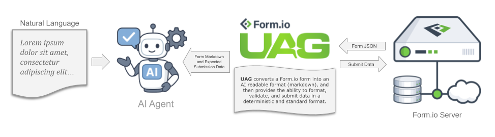
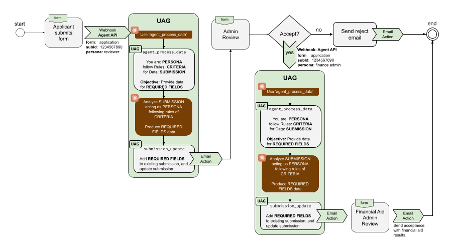
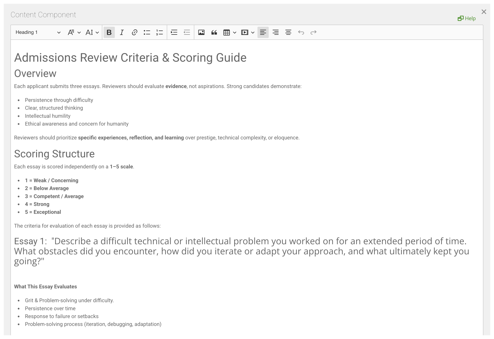
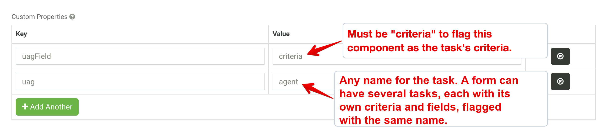
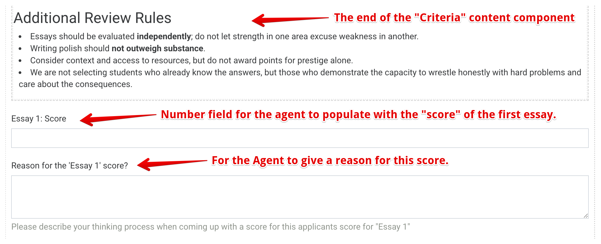
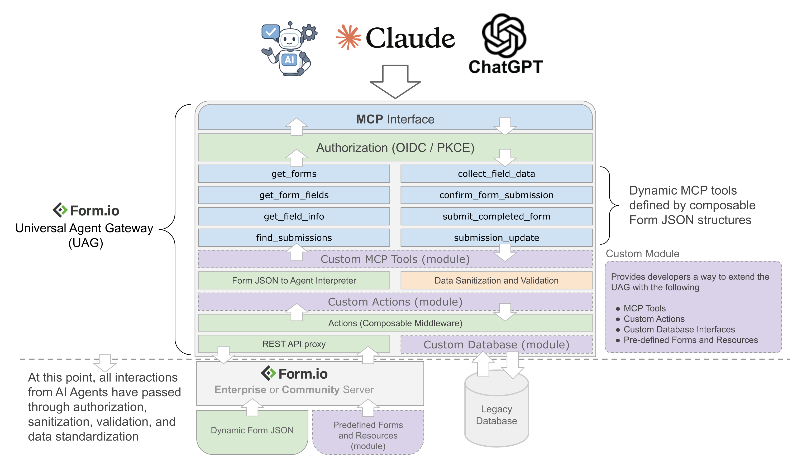

<p align="center">
  
</p>

<p align="center">
  <a href="https://www.npmjs.com/package/@formio/uag"></a>
  <a href="https://hub.docker.com/r/formio/uag"></a>
  <a href="https://registry.modelcontextprotocol.io/v0/servers?search=io.form/formio-uag"></a>
  <a href="./LICENSE.txt"></a>
</p>

The Universal Agent Gateway (UAG) leverages the [Model Context Protocol (MCP)](https://modelcontextprotocol.io/docs/getting-started/intro) to enable in-process agentic automation using Form.io. It provides to an AI Agent the same thing that our [JavaScript Renderer](https://github.com/formio/formio.js) provides to a human; an interpretation of the Form JSON schema into an understandable format. In the case of UAG, it transforms the Form JSON model into an AI readible markdown format so that the Agent can easily understand the purpose and structure of the data that needs to be collected.


--------------------------
There are two primary scenarios that the UAG enables:

 - **Unstructured 'chat' input to deterministic form submission**:  This capability uses the JSON schema of a Form.io form to produce a deterministic structured data object provided natural language conversational input. 

 
 
For a working example of this flow, try the [Conversation Forms demo](https://ai.onform.io/examples/conversation).

 - **Agentic Form.io Workflows**: UAG provides an AI Agent the ability to take existing submission data + "context" criteria in order to prompt an AI Agent to provide its own data and analysis within a workflow scenario. The following example, which shows a college application process using a Form.io application form, shows how this primary scenario works.

  

For more information on Agentic workflows, checkout the dedicated [Agentic Workflows](#agentic-workflows) section. For a working example of this flow, try the [Agentic Workflow demo](https://ai.onform.io/examples/workflow).

---

One of the many benefits that the UAG has to offer is the ability to inject **Dynamic Context** into an AI processing cycle. This is achieved from the dynamic nature of the Form JSON schemas that can easily be modified and deployed to any environment without the need to update your application or re-train the agents within the process. Because of this, dynamic context changes can be injected seamlessly into an existing running process which will automatically update the behaviors of the Agents utilizing the UAG.

## Try it out!
Every example runs live at **[ai.onform.io](https://ai.onform.io/examples)**, the UAG's demo site, with a flow viewer beside each one that shows every call the agents make. The whole site is in this repository as one Docker Compose stack, in [`demo/`](./demo): its forms, the three demo back ends, the flow viewer and the developer documentation.

| Example | Pattern | Licensing |
|---------|---------|-----------|
| **[Conversation Forms](https://ai.onform.io/examples/conversation)** | **Conversational, your own UI.** A chat application whose questions come entirely from a form. No field names in the code — edit the form and the conversation changes. ([source](./demo/server/conversation.mjs)) | Open Source — free |
| **[Agentic Workflow](https://ai.onform.io/examples/workflow)** | **Autonomous.** A submission triggers an agent that scores it against a rubric and writes its decision back, which in turn triggers a second agent. No human, no chat window. ([source](./demo/server/workflow.mjs)) | Enterprise, or a hosted Form.io project |
| **[Agentic Formflow](https://ai.onform.io/examples/formflow)** | **Assisted form filling.** A claims wizard where the user describes what happened; fast decisions choose which pages appear and extraction prefills the rest, using the [Agent API](#agent-api). ([source](./demo/public/apps/formflow)) | UAG license, or a hosted Form.io project |
| **[Custom Module](demo/samples/custom-module)** | **Conversational, existing client.** Connect Claude Desktop to your forms and talk to them: "I would like to add a new customer." Built as a custom module, so roles and permissions decide what the agent may do. | Open Source — free |

The demo's [flow proxy](./demo/flow/proxy.mjs) is a small logging proxy that shows every leg of an agentic run live, which is the fastest way to see what an agent is actually doing.

## Documentation in this repository

This file is the main reference: what the UAG is, how to configure a form for it, how to deploy it, and how to troubleshoot it. The rest of the documentation lives next to the code it describes.

| Document | What it covers |
|----------|----------------|
| **README.md** (this file) | Concepts, [agentic workflow setup](#agentic-workflows), the [Agent API](#agent-api), the [MCP tools](#pre-defined-mcp-tools-providing-dynamic-context), [deployment](#deploying-uag), [environment variables](#environment-variables), and [troubleshooting](#troubleshooting). |
| [engines/jev](./engines/jev/README.md), [claude](./engines/claude/README.md), [openai](./engines/openai/README.md), [grok](./engines/grok/README.md), [gemini](./engines/gemini/README.md) | The official **engines** for the Agent API: the JEV and OpenAI decision engines, and the Claude, OpenAI, Grok and Gemini agent engines. |
| [packages/engine-sdk/README.md](./packages/engine-sdk/README.md) | **Writing an engine package**: the engine contract, settings, the loader and the conformance check. |
| [packages/engine-server/README.md](./packages/engine-server/README.md) | The **engine server**: running engines in their own container, so model keys stay out of the UAG. |
| [renderer/README.md](./renderer/README.md) | The **Agent Input** renderer plugin that fills forms and wizards from the Agent API as users type. |
| [module/Readme.md](./module/Readme.md) | Building a **custom module** — adding your own MCP tools, form actions, pre-defined forms and resources, and configuration overrides, then mounting it into the Docker container. |
| [demo/samples/custom-module/Readme.md](./demo/samples/custom-module/Readme.md) | Example — a custom module driven conversationally from **Claude Desktop**, where roles and permissions govern what the agent may do. |
| [demo/README.md](./demo/README.md) | The **demo site** at [ai.onform.io](https://ai.onform.io): the live Conversation Forms, Agentic Workflow and Agentic Formflow demos, the flow viewer, and how to deploy the whole site as one Docker Compose stack. |
| [demo/content/developers](./demo/content/developers) | The **developer documentation** published at [ai.onform.io/developers](https://ai.onform.io/developers): architecture, MCP tools, the Agent API, engines, the engine SDK, modules and the renderer plugin. |
| [demo/samples/engines/Readme.md](./demo/samples/engines/Readme.md) | **Engine setups**: compose overrides for an engine server, several instances of one engine, and a local model through Ollama. |
| [demo/samples/custom-module/module/templates/Readme.md](./demo/samples/custom-module/module/templates/Readme.md) | Overriding the **response templates** the UAG returns to the agent, using Lodash templates. |
| [test/e2e/Readme.md](./test/e2e/Readme.md) | The **end-to-end test suite** — its three layers, what each covers, and how to run it. |

---

## Agentic Workflows
The UAG lets a generally trained model fill in part of a form by following instructions written in the form itself. A form defines **tasks**: each task is a **Criteria** content component that says what to do, the **Agent Fields** the task fills, and optionally an input field to read from. Because the instructions live in the form, you change what the agent does by editing the form, not by retraining a model or redeploying an application.

For example, suppose you want to automate the review behind a college application. An applicant submits academics, activities and essays; historically an administrator read each one and decided. With a task on the application form, the UAG fills in the review as soon as the application is submitted.


A task works from three things:

 - **Existing submission data**: the values the task reads (the whole submission, unless the task names an input).
 - **Criteria**: the instructions the task follows, and how to fill each of its fields.
 - **Agent Fields**: the fields the task fills.

### Setup
 To configure a form for a task, designate a section of the form for the agent, much like a "For Office Use Only" section, except that an AI agent fills it in. A complete setup is four steps, and all four are required:

 1. **Tag the form `uag`** (described below) — without this the UAG will not register the form at all.
 2. Add the **Criteria** content component that teaches the agent what to do.
 3. Add the **Agent Fields** the task fills.
 4. Add a **Webhook action** that posts to the UAG's [`/agent/provide`](#agent-api) endpoint on submission, with an engine enabled (see [Chaining tasks into a workflow](#chaining-tasks-into-a-workflow) for the action's settings). This step requires the Enterprise Server, because the action has to set a request header and transform its payload; on Community Edition, call `/agent/provide` from your own code after creating the submission.

 For a working reference containing all four, see the [Agentic Workflow demo](https://ai.onform.io/examples/workflow), whose forms are in [`demo/module/project.json`](./demo/module/project.json).

#### Tagging the form `uag`
The UAG only registers forms that carry the `uag` tag. Any form without it is invisible to every agent and to every tool, including `get_forms`. In the Form Builder this is set under **Form Settings &rarr; Tags**; in a form's JSON it looks like this:

```json
"tags": ["uag"]
```

This is worth checking first whenever an agent insists that a form does not exist, because a missing tag produces no error anywhere — the form simply is not there as far as the agent is concerned. Note also that newly tagged forms are picked up on the next project cache expiry, so allow up to `PROJECT_TTL` seconds (see [Project Cache and TTL](#project-cache-and-ttl)).

#### Agent "Criteria" component
The first thing to configure is a **Content Component** that tells the agent how to interpret the data. For example, here is a Criteria content block written to assess a College Application Essay.



Write this content as you would write an instruction manual for a new employee who needs to understand the submission and fill in the fields that follow. If the task stands for a role, such as an admissions officer, say so here: the criteria is the only place the agent learns who it is acting as. Then flag the component with a custom property `uag` whose value is the **task's name** (for example `uag="application"`), and a property `uagField` with the value `criteria`. Below is what a properly configured criteria content component looks like.



#### Agent Fields
Anywhere in your form, you can flag fields for the task to fill. Any field whose `uag` property has the same value as the criteria component belongs to that task.

For example, below the **Criteria** of a College Application form may be fields that score the essay according to the criteria:



To flag each of these fields, add the `uag` property with the task's name:


**Nested Components**
You can also flag a collection of fields by wrapping them in a **Nested Component** (such as a Panel, Container or Fieldset) that carries the `uag` property; every field inside it then belongs to the task. Fields inside a Data Grid or Edit Grid are skipped, and listed in `excluded` with the reason `inside repeating rows`.

### Multiple tasks per form
A form can define several tasks, which is useful when separate evaluations happen at different stages of a process. In the college application example, the first task decides whether to admit the applicant; if they are admitted, a second task assesses financial aid with entirely different criteria.

To do this, give each task's components their own `uag` value. The admissions criteria and its fields carry `uag="application"`; the financial aid criteria, in another section of the form, and its fields carry `uag="finance"`. Each task reads the submission through its own criteria, so generally trained models can be taught each stage of the process in the form itself.

Agent fields do not have to sit next to their criteria, either. A `status` field in one panel can be flagged `uag="application"` while the field beside it is flagged `uag="finance"`, which is how a single workflow field can be owned by whichever task is responsible for that stage.

#### Chaining tasks into a workflow
Several tasks on a form are only useful if something triggers the later ones. Because each task saves to the submission, the natural trigger for the second task is the *first* task's save.

This is configured with a second Webhook action that fires on `update` rather than `create`, narrowed by a condition on a field that the first task sets:

```json
{
  "name": "webhook", "handler": ["after"], "method": ["update"], "priority": 0,
  "condition": {
    "conjunction": "all",
    "conditions": [
      { "component": "status", "operator": "isEqual", "value": "scholarshipEvaluation" },
      { "component": "awardLevel", "operator": "isEmpty" }
    ]
  },
  "settings": {
    "method": "post",
    "url": "http://formio-uag:3200/agent/provide",
    "headers": [{ "header": "x-token", "value": "<your project API key>" }],
    "transform": "payload = {form: 'application', submissionId: payload.submission._id, task: 'finance'};",
    "block": false
  }
}
```

In the college application workflow, the admissions task sets `status` to `scholarshipEvaluation` only for applicants on the scholarship track, so only those submissions wake the finance task. Applicants who were simply accepted or declined never trigger it.

> **Avoid loops.** The second task also saves the submission, which fires the same `update` webhook again. `/agent/provide` saves nothing when nothing changed, and fills a value field only while it is empty, so running a task again on its own output is a no-op. A condition should still test one of the task's own fields, as above, so the webhook does not call the UAG needlessly. Check operator names carefully: Form.io treats a condition with an unknown operator, or one naming a field that doesn't exist, as always true.

A complete, runnable version of this two-task workflow is the [Agentic Workflow demo](https://ai.onform.io/examples/workflow), in [`demo/`](./demo).

## Agent API

The Agent API runs a form's tasks inside the UAG and chooses the model for each field, so applications call one set of endpoints whatever models are behind them. Switching or adding a model is a configuration change.

Terms used below:

- An **engine** connects the UAG to a model. Its **type** is the adapter: `claude` (Anthropic's Claude models), `openai` (OpenAI, or any OpenAI-compatible server, such as Ollama or vLLM), `grok` (xAI), `gemini` (Google) or `jev` (TypeSafe's decision models). Each type is its own npm package, such as `@formio/uag-claude`.
- An **instance** is a configured engine you route to, named in `UAG_ENGINES`: `claude`, or `fast:claude` and `deep:claude` for two Claude instances with different settings.
- Each instance calls one **model**, such as `claude-haiku-5-5`.
- A **decision engine** answers closed-set fields with a calibrated confidence; an **agent engine** writes open values. Engines only answer: the UAG validates every value and saves it.

| Endpoint | Body | Purpose |
|---|---|---|
| `POST /agent/extract` | `form`, `task`, `text` or `data`, `overwrite` | Fill in a task's fields from free text: `text`, or the task's input field in `data` (for example a "describe what happened" field). Decision fields go to a decision engine and open values to an agent engine. Saves nothing. Needs create or update access to the form. |
| `POST /agent/decide` | `form`, `task`, `data`, `overwrite` | Decide a task's closed-set fields from `data`, quickly, with a calibrated confidence for each. Saves nothing. Needs create or update access. |
| `POST /agent/generate` | `form`, `task`, `data`, `overwrite` | Write a task's open values (text, dates, amounts, scores) from `data` with an agent engine. Saves nothing. Needs create or update access. |
| `POST /agent/provide` | `form`, `task`, `submissionId` | Fill a task in on a saved submission and save it once: decide its decision fields, generate its empty value fields, and reconcile the results (see [Results](#results)). For webhooks. Needs update access. |
| `GET /agent/capabilities` | | List the enabled engines, which operations they can serve, the edition, and whether Agentic Formflow is licensed (see [License](#license)). |

`task` names one of the form's tasks. When it is left out, `decide` and `generate` run every task on the form, each with its own criteria; `extract` runs every task with an input (every task, when `text` is given); and `provide` uses the form's only task, refusing with `400` a form that defines several. `overwrite` defaults to `false`: only empty fields are answered, and the rest are listed in `excluded` (`already has a value`). Forms are named by `form`; a form definition in the request is refused.

To decide and also generate on the same in-flight data, call `decide` and `generate` at the same time: decisions come back first, without waiting for the slower model.

**Earlier names.** Tasks used to be called personas, and the provide webhook sent the form as `formName`. Every endpoint still accepts `persona` for `task`, and `/agent/provide` still accepts `formName`, so a 1.x webhook transform keeps working with only its URL changed. Sending both names with different values is refused with `400`. The UAG logs one deprecation notice per kind of use; the old names will be removed in a future major release.

### License

The Agent API, the `agentDecide` action, the `agent_decide` and `agent_provide` MCP tools and `uag-eval` (together, Agentic Formflow) are Enterprise features. There are two ways to run them: with a Form.io license that includes the UAG (`LICENSE_KEY`), or against a project on Form.io's hosted service. Conversation forms (the MCP tools that collect, validate and submit a form) need neither, and run entirely on Form.io Open Source with an unlicensed UAG.

A license includes the UAG in one of two ways:

- **An online license**, validated with the Form.io license server like the Enterprise and PDF servers' licenses, whose key has the `uagServer` scope. The license allows a number of UAG servers, and each project endpoint a UAG serves counts as one; replicas of a UAG serving the same project count once. A UAG past that number is refused ("UAG server limit reached") and does not load its project. The Form.io portal lists the UAGs counted under UAG Servers.
- **An offline license** (`LICENSE_REMOTE=true`) with the `uag` option. It is issued for the project it serves, so it has no count, and is verified locally without contacting the license server.

A project on Form.io's hosted service needs no license: `PROJECT` is an `https:` URL on `form.io` or a subdomain of it, such as `https://myproject.form.io` or `https://api.form.io/project/<id>`, used with `PROJECT_KEY`. The project runs under Form.io's license, as the Enterprise edition, and Agentic Formflow runs with real engines. The UAG checks that the name can be trusted, and needs a license after all when:

- the UAG connects to a database of its own (`MONGO`);
- TLS certificate verification is off (`NODE_TLS_REJECT_UNAUTHORIZED=0`);
- certificate authorities beyond Node's bundled list are trusted (`NODE_EXTRA_CA_CERTS`, `NODE_USE_SYSTEM_CA=1`, `--use-system-ca` or `--use-openssl-ca`); or
- the server does not answer `GET /formio-config` with `onPremise: false`, as only the hosted service does. The UAG asks when it loads the project, and retries while the server cannot be reached.

When you self-host, Agentic Formflow needs a license in `LICENSE_KEY` that includes the UAG and allows the project's endpoint (any license allows `localhost` and other development endpoints). It is the same variable, and can be the same license, as the Form.io Enterprise and PDF servers use. A project on the UAG's own machine needs the license too. The only other allowance is the stub engines (`UAG_ENGINES=stub-decision,stub-agent`), which answer with placeholders, for trying the API out; it covers work that calls the engines, so `agent_decide` and `agent_provide`, which call none, still need the license.

`uag-eval` runs offline, so with a real engine it needs the license whatever `--project` names, a hosted project included.

`UAG_LICENSE`, the UAG's own license variable, is deprecated but still read, until UAG 3.0. When both are set, a feature is on when either license grants it, so `UAG_LICENSE` can only add to `LICENSE_KEY`; `LICENSE_KEY` is only checked when `UAG_LICENSE` is missing, unusable, or does not include the UAG for the endpoint. Startup logs which one licensed Agentic Formflow, and a refusal gives each one's reason.

Otherwise every Agentic Formflow request is refused with `403` and `{ requestId, error, code: "license_required", edition }`, and a save through the `agentDecide` action is refused the same way, with nothing stored. `GET /agent/capabilities` always answers, with `edition` (`enterprise` or `open-source`) and `formflow: { licensed, allowed, reason }`, where `reason` is `licensed`, `hosted`, `stub-engines` or `unlicensed` (`local-endpoint` is no longer reported). A hosted project reports `edition: "enterprise"` with `licensed: false` and `reason: "hosted"`: the project is on Form.io Enterprise, under Form.io's license rather than one of yours. The UAG also prints its edition when it starts.

MCP and conversation forms need no license. A license that includes the UAG also covers running against a self-hosted Form.io Enterprise project, so it is the only license a UAG needs; one that does not include the UAG cannot run it against a self-hosted Enterprise project at all.

### Engines and routing

Two kinds of engine plug in:

- **Decision engines** answer closed-set questions — pick an option, place on a scale, yes or no — with a confidence for each answer. The official ones are [`jev`](./engines/jev) (TypeSafe Jev, at around 70–500 ms per request) and [`openai`](./engines/openai#decisions) with `kind: decision` (OpenAI's Decisions API). Enable both and list them in `routing.decision` to fall back from one to the other.
- **Agent engines** write open values, and may first research with the read-only tools a task allows. The official ones are [`claude`](./engines/claude), [`openai`](./engines/openai) (which also reaches local OpenAI-compatible servers, such as Ollama), [`grok`](./engines/grok) and [`gemini`](./engines/gemini). Claude, Grok and Gemini have no decision API, so they answer decision fields only as the agent fallback, reported `calibrated: false`.

Engines are enabled as named instances of an engine type, with `UAG_ENGINES` (see [Environment Variables](#environment-variables)) or `config.engines`, which takes precedence:

```
UAG_ENGINES=jev,fast:claude,deep:claude
```

- A bare entry (`jev`) is an instance named after its type; `<name>:<type>` names it, so one type can run several times with different settings (`UAG_ENGINE_FAST_MODEL=claude-haiku-5-5`). Routing lists and `uagEngine` use instance names.
- A type is built in (`remote`, for an engine hosted by an engine server; `stub-decision` and `stub-agent`), given by the application (`config.engineTypes`), or an installed package: `@formio/uag-<type>`, then `uag-engine-<type>`. The Docker image includes `jev`, `claude` and `openai`. Other packages can be installed in a derived image, or mounted and listed in `UAG_ENGINE_PATH`; see [`@formio/uag-sdk`](./packages/engine-sdk) to write one.
- Each setting of an instance comes from its options, then `UAG_ENGINE_<NAME>_<SETTING>`, then the type's own variables (such as `CLAUDE_API_KEY`), then the type's default.
- Nothing named means no engine is enabled, and nothing changes. A type that is not installed, a duplicate name or a missing setting stops startup, with the instance named.
- `/agent/capabilities` lists each instance with its type, and its package and version when it came from one.

For each request the UAG sorts the task's fields:

| Field | Answered by |
|---|---|
| Radio, select with values, checkbox, select boxes, survey, and single-value resource selects whose whole resource fits the engine's option limit (255 for Jev) | The decision engine, then an agent engine if it fails or times out (marked `calibrated: false`) |
| Everything else (dates, amounts, names, free text, multi-value or large resource selects) | An agent engine |

Override the choice with `uagEngine` on a component, or on the task's criteria component for the whole task: an engine name, `decision`, `agent` (`llm` also works), or a comma-separated list tried in order. For the project, use `config.routing`.

#### Where engines run

- **In the UAG** (the default). The `formio/uag` image includes every official engine: `jev`, `claude`, `openai`, `grok` and `gemini`. `UAG_ENGINES` enables the ones you name, and the UAG calls their models directly. One container to run.
- **On an engine server.** [`formio/uag-engines`](./packages/engine-server) runs engines in their own container, so their API keys and model traffic stay out of the UAG. On the UAG, name the instance with the `remote` type (`UAG_ENGINES=claude:remote`, with `UAG_ENGINE_CLAUDE_URL` and `UAG_ENGINE_CLAUDE_KEY`). The UAG sends the engine server only its key, never a Form.io credential.

A deployment can mix both: `UAG_ENGINES=jev,claude:remote`. See [demo/samples/engines](./demo/samples/engines) for an engine server, several instances of one engine, and a local model through Ollama.

#### Building a smaller image

Each engine is its own npm package, and the UAG uses only the ones installed. For an image with fewer engines, install the UAG and just those packages, and start it with the `uag` command:

```dockerfile
FROM node:lts-alpine AS build
WORKDIR /app
# isolated-vm, which runs form logic, compiles on install.
RUN apk add --no-cache make python3 g++
RUN npm install --omit=dev @formio/uag @formio/uag-claude

FROM node:lts-alpine
WORKDIR /app
COPY --from=build /app/node_modules ./node_modules
# Optional: your module (forms, actions, configuration).
# COPY module ./module
# ENV UAG_MODULE=./module
ENV NODE_OPTIONS=--no-node-snapshot
ENTRYPOINT ["node_modules/.bin/uag"]
```

Configure it as you would `formio/uag`, with `UAG_ENGINES=claude` and `CLAUDE_API_KEY`. Naming an engine whose package is not installed stops startup with the package to install.

### Setting up a form

Tasks work as they do for [Agentic Workflows](#agentic-workflows), with one more role and a few optional properties:

| Property | On | Meaning |
|---|---|---|
| `uagField: "input"` | Any field or container | The task's source text, for `extract`. Without one, the task reads the whole submission except its own fields. |
| `uagContext` | The task's criteria component | Extra data paths (comma-separated) sent to the engines alongside the input. Engines also get the criteria text and today's date, and nothing else from the form. |
| `uagTools` | The task's criteria component | Read-only MCP tools (comma-separated, e.g. `find_submissions, get_forms`) the agent may use to research the task's value fields in `generate` and `provide`. None by default. A tool that may write, or does not exist, is refused with `400`. |
| `uagThreshold` | A decision field | Confidence needed to accept a Choice or Score answer. Default 0.5. |
| `uagUncertainBand` | A decision field | Range treated as unsure, e.g. `0.1-0.5`. Default `0.2-0.8`. It applies to yes/no answers, and to whether the input addresses a field at all: below the band the field is left empty ("not mentioned"), inside it the field is `uncertain`. |
| `uagOptionDescriptions` | A radio or select | JSON object of option value → description. Required for an ordered field (`uagScale: "true"`) to be asked as a scale. |
| `uagOrderCheck: "false"` | A radio or select | Do not ask again with the options in reverse order. By default, an answer that changes when the order is reversed is `uncertain`. |
| `uagConfidenceField` | A decision field | Key of a field that receives the decision's confidence, for your own conditionals. When a decision is `uncertain`, the value written is just below the field's threshold, so a `lessThan` the threshold condition matches every uncertain decision. |
| `uagAuthoritative: "true"` | A decision field | Server-side reconciliation (the `agentDecide` action, or `/agent/provide`) always wins for this field. Any answered result that is not `confident` (uncertain or missing) clears it. When no engine can answer at all (failure, timeout, rate limit, none enabled), the save is refused instead (`503`, or `429`), so nothing is cleared. |
| `uagAgentDecides: "true"` | A decision field | Server-side reconciliation also writes an agent engine's answer, which is not calibrated, as it writes a confident one, replacing the stored value. For workflows that run with an agent engine and no decision engine, such as a webhook chain where one task's decision starts the next. Each `/agent/provide` run asks the agent again, so a person's later change to the field can be overwritten. |

> **Keep values when pages hide.** If decision fields can be hidden by conditionals, set `clearOnHide: false` on the fields themselves. Form.io clears a hidden field according to the field's own setting; `clearOnHide: false` on the page or container around it does not protect it. Otherwise hiding a page wipes the values that decided it.

### Results

Extract, decide and generate answer `{ requestId, tasks, data, fields, errors, excluded, engines }`: `tasks` lists the tasks that ran, `data` is the request's data merged with the results and validated by the form, and `excluded` lists target fields left out with a reason (`already has a value`, `hidden by the form's conditionals`, `inside repeating rows`, `not requested`). Every entry in `fields` has `value`, `status` (`confident`, `uncertain`, `suggested` or `missing`), `task`, `engine`, `model`, `calibrated`, and where available `confidence`, `reason` and up to three `alternatives`. A resource select whose input names no existing record has `noMatch: true` and, when the input names one, `newRecordName`. Agent-engine values are always `suggested`, and a value that fails validation is never `confident`. Each entry in `engines` names the engine group's task, engine, model, latency, the engines passed over (`attempts`), and, when the agent researched, the tools it called (`toolCalls`).

For extract, send `Accept: text/event-stream` to receive one `result` event per engine group as soon as it finishes (decisions arrive first), an `error` event for a group whose engines all failed, then a `done` event with the response above. Decide and generate always answer with one JSON response.

`/agent/provide` answers `{ requestId, task, submissionId, written, cleared, fields, excluded, engines, modified }`, where `written` holds only the values that changed and `cleared` the `uagAuthoritative` paths it emptied. It reconciles the results with the saved submission:

- decision fields, including hidden and filled ones, follow the rules of the [`agentDecide` action](#credentials-and-security): confident results are written (and an agent engine's answers, on `uagAgentDecides` fields), `uagAuthoritative` fields the server cannot confirm are cleared, and other stored values are kept, since a person may have confirmed them;
- value fields are generated only while empty and visible, and a generated value is never written over one already there.

It saves only when a value changed or was cleared (a changed confidence alone is not saved). The save goes back through the UAG, so the form's own `agentDecide` action, if installed, runs on it too. When the reconciled submission fails validation it returns `422` with `details`, and nothing is saved. When some fields cannot be answered at all (every engine that could answer them failed, timed out or was over its rate limit, or, for decision fields, none is enabled), nothing is cleared and nothing is saved: it answers `503`, or `429` when every engine is over its rate limit. Value fields that no enabled engine can answer are left empty. If the submission changes while the task runs, the task runs again on the new version, so the change is not saved over; if it changes again, the answer is `409` and nothing is saved.

Server-side reconciliation records each decision's provenance in `metadata.uag.decisions[path]` (`engine`, `model`, `confidence`, `status`, `at`, `serverValue`, and `source`: `server`, `client`, `cleared` or `none`), and each generated value's in `metadata.uag.generated[path]` (`engine`, `model`, `status`, `at`).

| Status | Cause |
|---|---|
| `400` | Missing `form` or `submissionId`; an unknown task; a form with several tasks and no `task` (provide); extract with no `text` for a task with no input; `submissionId` sent to decide; a form definition instead of a form name; `task` and `persona` that disagree; a task whose `uagTools` names a tool that may write or does not exist. |
| `401` | No valid credential, a scoped token, or an admin credential sent with an `Origin` header. |
| `403` | The caller lacks the form access listed above, or Agentic Formflow is not licensed (`code: "license_required"`, see [License](#license)). |
| `404` | The form does not exist or is not tagged `uag`, or the submission was not found. |
| `409` | Provide: the submission kept changing while the task ran. |
| `422` | Provide: the reconciled submission fails validation. |
| `429` | The caller is over its rate limit (with `Retry-After`), or every engine that could answer is. |
| `503` | No enabled engine can serve the operation; or, for provide and saves through the `agentDecide` action, some fields could not be answered at all. |

Error bodies are `{ requestId, error }`, with `code` and `edition` added when the license is missing. Every response after authentication carries an `X-Request-Id` header (send one to set it: up to 128 letters, digits, `.`, `_`, `:` or `-`, or the UAG uses its own); search the UAG logs for it when a request fails. Remote engines receive it too, and the engine server sends it on with its research calls to `/mcp`.

### Credentials and security

| Header | Mode |
|---|---|
| `Authorization: Bearer <UAG token>` | Runs as that user; Form.io permissions apply. Use this from browsers. |
| `x-token: <PROJECT_KEY>` or `x-admin-key: <ADMIN_KEY>` | Runs as administrator, for webhooks and servers. Refused on any request with an `Origin` header. |

Scoped tokens are refused on `/agent/*` (`401`); they are only for a remote engine's calls back into `/mcp`.

- **No model ever holds a write tool.** The UAG validates every value and writes it itself, once. Text in a submission cannot make a model create or change submissions.
- **Extract and decide give models no tools.** Generate and provide give an agent engine only the read-only tools its task lists in `uagTools`, none by default. Research runs with the caller's identity: for a webhook calling with the project or admin key, that is administrator access, so list only tools the task needs, and only on forms whose submissions you trust.
- **Remote engines get a scoped token** for research: it carries the caller's identity and the task's read-only tools, and `/mcp` lists and allows only those (never a tool that may write, even if a token names one). It lasts as long as the research timeout (`agentApi.research.timeout`). Work that needs no tools gets no token.
- **Re-decide on the server before saving.** Values decided in the browser can be changed by the user. Add the built-in **`agentDecide`** action (handler `before`, methods `create`/`update`, setting `task`) to forms whose triage drives sensitive routing. It re-decides with the caller's identity. Confident results are written, `uagAuthoritative` fields the server cannot confirm are cleared, and other values are kept, since a person may have confirmed them. When some decision fields cannot be decided at all (every engine that could answer them failed, timed out or was over its rate limit, or none is enabled), nothing is cleared and nothing is saved: the save is refused with `503`, or `429` when every engine is over its rate limit. It runs only for submissions saved through the UAG. For submissions saved directly to Form.io, add an after-save webhook that posts `{ form, task, submissionId }` to `/agent/provide`; it reconciles the saved submission the same way (see [Results](#results)), and saves nothing when nothing changed, so it does not trigger itself again. Actions configured with the earlier `persona` setting keep working.

Callers and engines can be rate limited with `agentApi.rateLimits`. An engine over its limit is skipped and the next one tried; a `429` comes back only when the caller is over its own limit or every engine is. Counters are kept in memory per process, so each instance of a multi-instance deployment has its own allowance.

| Setting (`config`) | Default | Meaning |
|---|---|---|
| `engines` | `UAG_ENGINES` | Engine instances to enable: `"<type>"`, `"<name>:<type>"`, or `{ name, type, options }`, where `type` may also be an engine type definition. |
| `engineTypes` | none | Engine types the application provides, by type name, resolved before the built-in types and packages. |
| `routing.decision`, `.value` | `['decision', 'agent']` for decision, `['agent']` for value | Engine preference lists, tried in order. |
| `routing.timeouts[engine]` | `agentApi.timeout` | Milliseconds before one engine's call is abandoned and the next engine is tried. |
| `agentApi.timeout` | 30000 | Default engine timeout. |
| `agentApi.research.timeout` | 120000 | Milliseconds a researching agent engine may take, and its scoped token's lifetime. |
| `agentApi.research.maxIterations` | 10 | Tool-use round trips before a researching engine must answer. |
| `agentApi.threshold` | 0.5 | Default `uagThreshold`. |
| `agentApi.uncertainBand` | `[0.2, 0.8]` | Default `uagUncertainBand`. |
| `agentApi.rateLimits` | none | `caller` (by operation — `extract`, `decide`, `generate`, `provide` — or `default`) and `engine` (by engine name or `default`), each `{ limit, windowMs }`. |

Pass these to `new UAGServer(config)` or in a module's `config`.

### Choosing thresholds

Measure on your own forms before relying on the default thresholds:

```bash
docker run --rm -v "$PWD:/work" -w /work -e TYPESAFE_API_KEY -e LICENSE_KEY --entrypoint node formio/uag \
  --no-node-snapshot /app/bin/uag-eval.js --form claim.json --examples claim-examples.json --task triage --engine jev \
  --project https://forms.example.com/claims --json report.json
```

Evaluating a real engine needs a license (`LICENSE_KEY`) that includes the UAG for the project URL passed as `--project`; the stub engines need neither. `uag-eval` loads the engine as the UAG does, so `--engine` takes an instance named in `UAG_ENGINES` (evaluated with its own `UAG_ENGINE_*` settings) or an entry such as `next:jev`. The engines are in the Docker image; with the npm package, install the engine's package next to it (`npm install @formio/uag @formio/uag-jev`). From a checkout, `yarn install && yarn build`, then `node --no-node-snapshot bin/uag-eval.js` with the same arguments. (`--persona` is accepted for `--task`.)

`examples` is a JSON array of `{ "data": {...}, "expected": { "<field path>": <value, or null for "not mentioned"> } }`. The report shows, for each decision field, the accuracy of automatic decisions and how many were automatic at each threshold. Run it again before changing a threshold or the pinned model version (`TYPESAFE_MODEL`).

### Filling in forms as users type

The [renderer plugin](./renderer) connects a formio.js form or wizard to `/agent/extract`:

```js
UAGAgent.attach(form, { baseUrl: 'https://uag.example.com', formName: 'claim', task: 'triage', getToken: () => userToken, trigger: 'next' });
```

It never overwrites a value the user entered, and on wizard **Next** it waits (briefly) for decisions so conditional pages are in place. When those decisions show pages the form was hiding, it asks once more to fill them. See the [Agentic Formflow demo](https://ai.onform.io/examples/formflow).

---
## Packages and versions

UAG 2.0 runs agents through the [Agent API](#agent-api), with the engines in the UAG (the `formio/uag` image includes them all) or on an engine server. The Claude integration (`@formio/uag-claude` 1.x, image `formio/uag-claude`) is retired: point its webhooks at `/agent/provide` instead (see [MIGRATING-2.0.md](./MIGRATING-2.0.md)). A deployment that cannot move yet can keep running `formio/uag-claude` 1.3.x against UAG 2.0: its commands and `agent_provide_data` webhooks keep working, and it gets security fixes only, from the `1.x` branch.

**`@formio/uag-claude` 2.0 is not the integration.** From 2.0.0 the name carries the Claude *engine*, which runs inside the UAG and works only with `@formio/uag` 2.x. The integration stays on 1.x, and on the `formio/uag-claude` image. Pin `@formio/uag-claude@^1` if you install the integration from npm.

The engine packages start at 2.0.0, with the UAG, and are then **versioned independently of it**. Use this matrix to pick a compatible set:

| Package | Version | Compatible UAG versions | Notes |
| ------- | ------- | ----------------------- | ----- |
| `@formio/uag-sdk` | 2.x | >= 2.0.0 | Engine contract version 1, remote engine protocol version 1. |
| `@formio/uag-jev` | 2.x | >= 2.0.0 | Default model `jev-1.13.0`. |
| `@formio/uag-claude` | 2.x | >= 2.0.0 | The Claude engine. |
| `@formio/uag-openai` | 2.x | >= 2.0.0 | No default model. 2.1 adds the decision kind (OpenAI's Decisions API). |
| `@formio/uag-grok` | 2.x | >= 2.0.0 | Built on `@formio/uag-openai`. No default model. |
| `@formio/uag-gemini` | 2.x | >= 2.0.0 | Built on `@formio/uag-openai`. No default model. |
| `@formio/uag-engines` | 2.x | >= 2.0.0 | The engine server; remote engine protocol version 1. |
| `@formio/uag-renderer` | 0.1.x | >= 2.0.0 | Used from this repository's [`renderer`](./renderer) folder; not published. |
| `@formio/uag-claude` | 1.3.x | >= 1.12.0 | The retired Claude integration, deprecated. Works against 2.0 as it did against 1.13. |
| `@formio/uag-claude` | 1.2.x | 1.10.0 – 1.11.x | The retired Claude integration. |

Published packages and images:

- npm: [`@formio/uag`](https://www.npmjs.com/package/@formio/uag), and the engine packages above.
- Docker Hub: [`formio/uag`](https://hub.docker.com/r/formio/uag), which includes the official engines, and [`formio/uag-engines`](https://hub.docker.com/r/formio/uag-engines), the engine server.

**When adding a row:** bump the package's own `package.json` version. CI publishes it on the next release tag, and skips it when that version is already published, so a UAG-only release does not republish unchanged engines.

The [`demo/samples`](./demo/samples) compose files reference images without a tag, so they always pull the current release. For a reproducible stack, pin the images to a compatible set from the matrix above.

---

## Technical Overview
The UAG can be thought of as consisting of many layers of functionality. Each layer is broadly either serving to fetch dynamic context, or submit deterministic data structures. The following layers are leveraged within the UAG:

 1. **MCP Interface**:  The entry point of the UAG is the MCP interface that sits between the AI agent and the tools that are executed on the server.
 2. **Authorization**:  As part of the MCP specification, every interaction between the AI agent and the backend service must pass through an Authorization process leveraging OIDC (PKCE) authentication. The UAG takes this process one step further, however, by adding an OIDC (PKCE) authentication layer on top of the existing authentication flexibilities that Form.io already provides. Because of this, it is possible to authenticate with the UAG if you are using SAML, Form.io Authentication, OIDC, or even Custom Authentication processes through the Form.io platform.
 3. [**Pre-defined MCP Tools providing Dynamic Context**](#pre-defined-mcp-tools-providing-dynamic-context): The UAG utilizes the MCP to provide a number of pre-defined tools that provide AI agents with dynamic context based on the Forms and Resources marked as compatible within the Form.io platform. These tools are described in more detail in a section below.
 4. **Custom Tools** (provided by [Custom Modules](#custom-modules)): This enables developers to introduce any new tools that can leverage Form.io forms and submission data structures to provide additional capabilities introduced to the AI agents. This would allow for custom agent interactions to achieve certain goals for specific use cases.
 5. **Custom Actions** (provided by [Custom Modules](#custom-modules)): Enables developers to create composable middleware that will be executed once all data provided by the AI agent has been sanitized and validated. This provides the ability to interface the data collected from AI agents with any backend system or workflow.
 6. **Built-in Actions**: In addition to any custom actions introduced via a Module, the UAG supports a handful of existing Actions that can be assigned to any form or resource. Actions such as the **Webhook** that will send a REST API call to any endpoint whenever a matching submission is made, including by an AI agent. This can be used to point to any serverless function to instigate backend workflows that are triggered from the interactions from AI agents.
 7. **Pre-defined Forms and Resources** (provided by [Custom Modules](#custom-modules)): Allows a developer to release a module that provides default data structures to the AI agent. This would be useful if a developer wishes to create a module that achieves a specific goal, where the data structures required for that goal need to follow a pre-determined set of fields provided by a form or resource. For example, if a developer wishes to release a CRM module for the UAG, then it would make sense that the module would also provide the default **Customer** and **Company** resources that commonly accompany most CRM implementations. 
 8. **Custom Database** (provided by [Custom Module](#custom-modules)): By default, the UAG performs the data collection and retrieval via a "Submission Proxy", whereas the data is submitted via REST API to either the Enterprise Server project or the Open Source server. This, however, could be modified to send the data directly to and from a Database. This can be achieved via the Database Interface provided from the UAG. For more information, see the **Module** documentation. This feature does require that the UAG is connected to the Enterprise Server.
   
Here is a diagram to understand how all of these layers are organized to make up the UAG.



### Pre-defined MCP Tools providing Dynamic Context
The following tools provided by the UAG can be described as follows:

| Tool Name       | Tool Description     |
|-----------------|----------------------|
| get_forms       | Provides the AI agent with a list of available forms. <br/>It will only return forms that have been tagged `uag`. |
| get_form_fields | When the AI agent infers the user intends to use a specific form, this tool provides the agent with a high level overview of all the fields needed (along with the field data path) to submit that form. |
| get_field_info | Once the fields have been determined using `get_form_fields`, this tool provides specific information about the requested fields, such as validation, conditionals, input formats, etc. <br/>This tool instructs the AI agent on how to format and structure the data that is sent to the MCP server. |
| collect_field_data  | Provides the AI agent with a mechanism to dynamically collect the required information from the user. It can parse the user's input into multiple fields at once, and will identify additional inputs from the user if needed. <br/>This tool supports complex and structured data collection and is compatible with nested or multi-value fields like nested forms, data grids, etc.       |
| confirm_form_submission | This tool is used to provide a summary of all data collected before a submission is made to the form. |
| submit_completed_form | Provides the AI agent with the ability to submit all of the data collected from the user to create the form submission. |
| find_submissions | Enables the agent to parse a user's natural language request into a query for a submission, or a specific field of a particular submission. |
| submission_update | Provides the AI agent with the ability to update an existing submission, either by supplying unfilled fields or updating existing ones if allowed. Provides the AI agent with the context of the existing field values, allowing inline changes or edits. |
| agent_provide | Enables an AI Agent to be able to analyze existing submission data according to rules defined with a configurable **Criteria**. It will then instruct the Agent to provide generated data for the fields of a form's **task** (its `task` argument; `persona` is still accepted) using the `submission_update` tool. Please read the [**Agentic Workflows**](#agentic-workflows) section for more information about this toolset. `agent_provide_data`, its name before 2.0, is still served with the same arguments, and is deprecated. |
| agent_decide | Returns a task's decision questions (from a `submission_id` or `form_data`) as structured JSON: the state to decide on, each question, and how each answer maps back to a field value. It calls no model, so the agent answers the questions itself (or with a decision model) and writes the values with `submission_update`. Listed whether or not any engine is enabled. See the [Agent API](#agent-api). |
| fetch_external_data | This tool enables an AI Agent to pull external data into a form workflow through the use of either a Resource component, Select with URL, or a Data Source component. |

### Custom Modules
While the UAG can be used as a stand-alone system to enable the interaction between AI agents and dynamic JSON forms, the true power of this platform will be realized when developers extend the capabilities of this platform to solve industry specific use cases through the use of Custom Modules and Tools. It is possible for a developer to create a **Module** that introduces a number of custom tools, actions, and pre-defined resources and forms to achieve interactions with industry specific technologies. They are able to achieve this custom integration capabilities through the use of the following mechanisms:

 1. **Pre-defined Form and Resources**: Using the Form.io template system, a custom module can include a template export of a Form.io project that includes a number of Forms, Resources, and Actions (as well as any Roles and Permissions associated with them). By using the module, this will then automatically "register" these assets so that the AI agent is immediately aware of those assets. The project, not the module, is the source of truth: the template only provides what the module needs the project to have. At startup, the forms, resources and actions the project does not have yet are installed, matched by key, including new actions on forms the project already has. Nothing the project already has is changed, so a changed form or action in the template is not applied. Apply such changes in the portal, through a stage deployment, or by posting the template to the project's `/import` endpoint with an admin or project key, which updates existing forms in place (keeping their submissions) and replaces their actions. `TEMPLATE_SYNC` sets when the template is installed: `boot` (the default) at startup, `refresh` also on every `PROJECT_TTL` refresh, or `off` never. Because `boot` runs at every startup, a form or action from the template that was deleted from the project is installed again on the next restart; use `off` when the project's forms are managed through stage deployments.  
 For example, imagine a module includes a Customer resource with "First Name", "Last Name", and "Email" fields. If you then simply ask an AI agent, "I would like to add a new Customer" the agent will automatically be aware of the context for the customer data structures and know exactly what your intent is when making that request.
 2. **Custom Actions**: Actions can be thought of as composable middleware functions that allow for configurable Express.js middleware functions to be attached to any Form and Resource, and then to be executed once the data being submitted by an AI agent has passed through the proper data validations and sanitization. These can be used to provide custom integrations to backend processes and workflows.
 3. **Custom Tools**: In addition to providing custom actions, a Module can also introduce custom MCP Tools to provide bespoke interaction capabilities between the UAG and the AI agents for any industry specific purposes.
 4. **Custom Authentication**: A module can also modify the "authentication" landing page to assist with any custom requirements that are needed around Authentication. 
 5. **Behavior Overrides**: A module also has the ability to "override" any default behavior from the UAG. This ensures that whomever is using a certain module can "tweak" certain tools and responses to achieve better results as it pertains to their industry specific needs.

Form.io aims to enable developers to build and contribute their own custom modules to the broader community through GitHub and NPM. 

#### Using a Custom Module
Once a custom module is developed, anyone can install that module (via NPM) and then easily use your module in the following way...

<sub>This is just an example.</sub>
```js
import { UAGServer } from '@formio/uag';
import { ExampleUAG } from '@example/uag';
import Express from 'express';
try {
    (async function () {
        const server = new UAGServer();
        server.use(ExampleUAG);
        const app = Express();
        app.use(await server.router());
        const port = process.env.PORT || 3200;
        app.listen(port, () => {
            console.log(`Form.io UAG server running on port ${port}`);
            console.log(`Visit http://localhost:${port} to access the application`);
        });
    })();
} catch (error) {
    console.error('Failed to start server:', error);
    process.exit(1);
}
```

To get started in building your own custom module, go to the help documentation at [Modules Readme](./module/Readme.md).

## Deploying UAG
The following sections describe the process of creating a running instance of UAG, connecting it to the Form.io Platform, and configuring an AI agent to use it.

This documentation focuses on using UAG with Form.io Open Source. For documentation on using UAG with Form.io Enterprise, refer to [https://help.form.io/uag](https://help.form.io/uag).

### How Agents Connect
Before deploying, it is worth deciding **which side opens the connection** to the UAG's `/mcp` endpoint, because that single decision determines whether the UAG needs to be publicly accessible.

| Connection model | Who runs the MCP client | Does the UAG need a public domain? |
|------------------|-------------------------|------------------------------------|
| **Local MCP client** | Your own application or integration, running alongside the UAG | **No.** The UAG only needs to be reachable from that process — `http://localhost:3200` or a private Docker network address is fine. |
| **Remote MCP client** | A hosted agent that dials into your UAG (Claude.ai and Claude Desktop connectors, the Anthropic MCP connector, or any other remote MCP host) | **Yes.** The agent must be able to reach `/mcp` and the OAuth discovery endpoints over the public internet. |

With a **local MCP client**, your application connects *out* to the UAG, calls the tools itself, and passes the results on to whichever model it is using. Nothing dials back in, so the UAG can stay entirely inside your network. This is how an engine server researches with the UAG's tools, and it is the recommended model for server-to-server and webhook-triggered automation — including running the whole stack on a developer machine.

With a **remote MCP client**, the agent lives outside your network and connects in, so `/mcp` and the `.well-known` OAuth discovery endpoints must be publicly reachable over HTTPS, and `BASE_URL` must be that public URL. See [Domain and URL Configuration](#domain-and-url-configuration).

Both models can be used against the same UAG deployment at the same time.

#### Authenticating a local MCP client
A remote agent authenticates through the browser-based OAuth (PKCE) flow. A local client has no browser, so it exchanges a server-side key for an access token using the `client_credentials` grant against `{{ BASE_URL }}/auth/token`, then sends that token as a `Bearer` token on its `/mcp` requests.

The `client_id` must be prefixed with the project name — which is `formio-oss` for Open Source deployments:

```
POST /auth/token
Content-Type: application/json

{
  "grant_type": "client_credentials",
  "client_id": "formio-oss-x-admin-key",
  "client_secret": "{{ ADMIN_KEY }}"
}
```

For Enterprise (and a project on Form.io's hosted service), use the project name from your project endpoint together with the project API key — for example `"client_id": "myproject-x-token"` with `"client_secret": "{{ PROJECT_KEY }}"`. The endpoint is the same, `{{ BASE_URL }}/auth/token`.

The response contains an `access_token`, which is passed to the UAG as `Authorization: Bearer {{ access_token }}`. Tokens expire according to `JWT_EXPIRE_TIME`, so long-running clients should cache the token and refresh it before it expires. See `UagClient.accessToken` in [`demo/server/clients.mjs`](./demo/server/clients.mjs) for a working implementation.

### Runtime Environments
There are currently two run-time environments that work with the UAG:
 - [**Docker**](#docker)
 - [**Node.js (Express)**](#nodejs-express)


### Docker
Running the UAG in Docker enables a wide range of deployment options into common hosting environments such as AWS and Azure. Additionally, it allows for the use of common orchestration runtimes such as Kubernetes and Docker Compose. The container that you will run the UAG is as follows:

```
formio/uag
```

This container can be run in two ways:  
  - [**Docker-Compose.yml**](#docker-compose-recommended) - The recommended method, deploys as a multi-container Docker Compose stack.
  - [**Docker Run**](#docker-run) - a standalone container using the common `docker run` command.


#### Docker Compose (Recommended)
The recommended way to launch the UAG is through Docker Compose. This enables you to orchestrate several of the containers to run within a single instance to provide a more seamless and simple way of managing your deployments. Here is a simple example of how to run both the Form.io UAG + Form.io OSS server on the same instance.

docker-compose.yml
```
services:
  mongo:
    image: mongo
    restart: always
    volumes:
      - ./data/db:/data/db
    environment:
      - MONGO_INITDB_ROOT_USERNAME
      - MONGO_INITDB_ROOT_PASSWORD
  formio:
    image: formio/formio:rc
    restart: always
    links:
      - mongo
    depends_on:
      - mongo
    environment:
      PORT: 3000
      DEBUG: formio.*
      NODE_CONFIG: '{"mongo": "mongodb://mongo:27017/formio-oss", "jwt": {"secret": "CHANGEME"}, "mongoSecret": "CHANGEME"}'
      ROOT_EMAIL: admin@example.com
      ROOT_PASSWORD: CHANGEME
      ADMIN_KEY: CHANGEME
    ports:
      - "3000:3000"
  formio-uag:
    image: formio/uag
    restart: always
    links:
      - formio
    depends_on:
      - formio
    environment:
      PORT: 3200
      DEBUG: formio.*
      PROJECT: http://formio:3000
      ADMIN_KEY: CHANGEME
      JWT_SECRET: CHANGEME
      JWT_EXPIRE_TIME: 525600
      LOGIN_FORM: http://localhost:3000/user/login
      # The address clients reach the UAG at — this is the UAG's own port,
      # not the Form.io server's. See the BASE_URL section below.
      BASE_URL: http://localhost:3200
    ports:
      - "3200:3200"
```

This can be run by typing the following...

```
docker compose up -d
```

#### Docker Run
Here are some examples of running the UAG using the ```docker run``` command.

**UAG pointed to an Open Source server**
```
docker run -d \
  -e "PROJECT=https://forms.mysite.com" \
  -e "ADMIN_KEY=CHANGEME" \
  -e "JWT_SECRET=CHANGEME" \
  -e "BASE_URL=https://uag.mysite.com" \
  -e "LOGIN_FORM=https://forms.mysite.com/user/login" \
  -e "PORT=3200" \
  --restart unless-stopped \
  --network formio \
  --name formio-uag \
  -p 3200:3200 \
  formio/uag
```

**UAG pointed to a Form.io Enterprise Server**
```
docker run -d \
  -e "PROJECT=https://forms.mysite.com/myproject" \
  -e "PROJECT_KEY=CHANGEME" \
  -e "LICENSE_KEY=YOUR-LICENSE" \
  -e "JWT_SECRET=CHANGEME" \
  -e "PORTAL_SECRET=CHANGEME" \
  -e "BASE_URL=https://uag.mysite.com" \
  -e "LOGIN_FORM=https://forms.mysite.com/myproject/user/login" \
  -e "PORT=3200" \
  --restart unless-stopped \
  --network formio \
  --name formio-uag \
  -p 3200:3200 \
  formio/uag
```

Once it is running, you can then navigate to the following to access both the OSS Deployment + UAG Server
 - http://localhost:3000:  The Form.io OSS Server
 - http://localhost:3200:  The UAG Server

In both the Node.js runtime environment as well as Docker, the way to control the UAG is through the use of **Environment Variables** and **Modules**.

### Environment Variables
This module can be configured in many ways. One of those ways is through the use of Environment Variables, which are documented as follows.

| Variable | Description | Example |
|----------|-------------|---------|
| PROJECT | **Required.** The API Endpoint to either an Enterprise project endpoint, or the OSS server url. | http://localhost:3000 |
| PROJECT_KEY | (Enterprise Only) The API Key of the project this UAG is bound to, found in **Project Settings &rarr; API Keys**. Open Source deployments use `ADMIN_KEY` instead. | CHANGEME |
| ADMIN_KEY | (Open Source Only) Allows you to provide the ADMIN_KEY to install and connect to the OSS Server. | CHANGEME |
| LICENSE_KEY | The Form.io license to run the UAG against a self-hosted Form.io Enterprise Deployment, the same variable (and license) the Enterprise and PDF servers use. Not needed for a project on Form.io's hosted service (`https://*.form.io`); see [License](#license). A license that includes the UAG also enables [Agentic Formflow](#license) with real engines. | |
| LICENSE_REMOTE | `true` when the license is an offline license, so the Form.io license server is never contacted. | true |
| UAG_LICENSE | Deprecated: use `LICENSE_KEY`. Still read until UAG 3.0; a feature is on when either license grants it. | |
| PROJECT_TTL | The project cache TTL in seconds. This controls the amount of time to check for any "changes" that have been made to the project to refresh any forms and resources within the UAG. | 900 |
| TEMPLATE_SYNC | When a [module's template](#custom-modules) is installed into the project: `boot` once at startup, `refresh` also on every `PROJECT_TTL` refresh, or `off` never. Only what the project is missing is installed. Use `off` when the project's forms are managed through stage deployments. | boot |
| PORT | The port you wish to run the server on. | 3200 |
| DEBUG | Variable used to perform debug logs of server activity | formio.* |
| PORTAL_SECRET | Enterprise Only:  Allows you to connect to the UAG from the Form.io Enterprise Portal. | CHANGEME |
| JWT_SECRET | **Required.** A secret used to generate and validate JWT tokens generated through the authentication process of the UAG. This does not need to match the JWT_SECRET of the Enterprise Server that it is connected to. | CHANGEME |
| JWT_EXPIRE_TIME | Lifetime of the tokens the UAG issues, in **minutes** (3600 is 60 hours). | 3600 |
| MONGO | (Enterprise Only) Allows you to connect the UAG directly to a mongo database, rather than having to redirect the submissions to the Form.io Submission APIs. | |
| MONGO_CONFIG | JSON configuration for the Node.js Mongo Driver. | |
| BASE_URL | **Required.** The URL that the UAG is reachable at *by its clients*. It is published in the `.well-known` OIDC (PKCE) definitions and used for authentication callbacks. This must be a public URL when remote agents connect in; for a local MCP client, a private or localhost URL is fine. | https://forms.yoursite.com |
| LOGIN_FORM | The URL to the Login Form JSON endpoint, loaded by the `/auth/authorize` page. Only used by the browser-based login flow, so it must be reachable by that browser. | https://mysite.com/project/user/login |
| CORS | The cors domain, or the JSON configuration to configure the "cors" node.js module cross domain resource sharing. | *.* |
| NODE_TLS_REJECT_UNAUTHORIZED | Standard Node.js variable. Set to `0` when `PROJECT` is an `https` URL secured by a self-signed or otherwise untrusted certificate, which is common for local and internal deployments — without it the UAG cannot connect to the server and every tool call fails. Never set this on a deployment reachable from outside your network, since it disables certificate verification for all outbound requests. | 0 |
| UAG_ENGINES | Comma-separated engine instances to enable for the [Agent API](#agent-api), each `<type>` or `<name>:<type>`: `jev`, `claude`, `openai`, `remote` (an engine on an engine server), an installed engine package, and for local testing `stub-decision` and `stub-agent`. Unset or empty means no engines, and existing behavior is unchanged. `config.engines` overrides it; see [Engines and routing](#engines-and-routing). | jev,fast:claude |
| UAG_ENGINE_&lt;NAME&gt;_&lt;SETTING&gt; | One instance's setting, from its name and the setting's name (`apiKey` is `API_KEY`). It takes precedence over the engine type's own variables below. | UAG_ENGINE_FAST_MODEL=claude-haiku-5-5 |
| UAG_ENGINE_PATH | Absolute directories, separated by `:`, where more engine packages are installed (each with a `node_modules` folder), for example a mounted volume. | /engines |
| TYPESAFE_API_KEY | Required when `jev` is enabled. The TypeSafe API key. | |
| TYPESAFE_MODEL | The pinned Jev model version. Use a dated version, and run `uag-eval` before changing it. | jev-1.13.0 |
| TYPESAFE_BASE_URL | Optional TypeSafe API base URL for the `jev` engine. | |
| CLAUDE_API_KEY | Required when `claude` is enabled (`ANTHROPIC_API_KEY` is also accepted). | |
| CLAUDE_MODEL | The Claude model for the `claude` engine. | claude-opus-5-5 |
| CLAUDE_EFFORT | Effort for extraction calls. | low |
| CLAUDE_RESEARCH_EFFORT | Effort for research with a task's read-only tools (`uagTools`), before the structured answer. | medium |
| CLAUDE_FALLBACKS | `default` re-runs a refused request on a fallback model server-side; `off` disables it. | default |
| OPENAI_MODEL | Required when `openai` is enabled; there is no default. See the [OpenAI engine](./engines/openai) for `OPENAI_API_KEY`, `OPENAI_BASE_URL`, `OPENAI_STRUCTURED_OUTPUT`, and `UAG_ENGINE_<NAME>_KIND=decision` for OpenAI's Decisions API. | |
| XAI_API_KEY, XAI_MODEL | Required when `grok` is enabled; there is no default model. See the [Grok engine](./engines/grok). | |
| GEMINI_API_KEY (or GOOGLE_API_KEY), GEMINI_MODEL | Required when `gemini` is enabled; there is no default model. See the [Gemini engine](./engines/gemini). | |
| UAG_ENGINE_&lt;NAME&gt;_URL | For a `remote` instance: the engine server hosting it, such as `formio/uag-engines`. At startup the UAG asks it for the engine's kind and model, retrying as it does for `PROJECT` (`PROJECT_RETRIES`, `PROJECT_RETRY_DELAY`). Research also needs `JWT_SECRET`, to sign the scoped token the engine server calls `/mcp` with. | UAG_ENGINE_CLAUDE_URL=http://engines:3300 |
| UAG_ENGINE_&lt;NAME&gt;_KEY | For a `remote` instance: the engine server key, at least 32 characters, the same as the engine server's `UAG_ENGINE_SERVER_KEY`. It is the only credential the UAG sends there; Form.io keys and tokens are never sent. `UAG_ENGINE_<NAME>_ENGINE` names the engine on the server when it differs from the instance name. | |

### Project Cache and TTL
By default, the UAG uses a TTL to "fetch" any of the project assets and register them and cache them into the UAG. What this means is that if you make any changes to your underlying project forms and resources (either directly or through a deployment), you need to wait a maximum of the TTL setting (in seconds) to see any updates that have been made. For example, if the TTL is set to 900 (or 15 minutes), and you make a change to any forms and resources, you must wait at most 15 minutes to see any of these changes take effect into the UAG. It should be noted that when a "refresh" occurs, an API call to the "export" method is called on the underlying project endpoint. This is a processor intensive API call, so it is not recommended to set the TTL to any value less than 60.  A value of 0 is interpreted as "No TTL", which means the only way to refresh the project forms and resources, a UAG reboot is necessary.

A refresh brings in everything about the project's current state: forms and resources that were added, changed or deleted, and the actions on them. It only reads the project; a module's template is installed at startup unless `TEMPLATE_SYNC` is `refresh`.

Here is a table explaining how this parameter can be used.

| Environment Variable | Value | Result |
|----------|-------------|---------|
| PROJECT_TTL | 0 | No TTL (refresh) will occur.  This can be used to "disable" any refresh and ensure the ONLY way to refetch updated forms and resources, you must reboot the UAG server. |
| PROJECT_TTL | 60 | Check for changes every minute |
| PROJECT_TTL | 3600 | Check for changes every hour |

This cache is the reason a form edit does not appear to take effect immediately. Anything that changes what the agent knows — adding the `uag` tag, rewriting a **Criteria** content component, adding or removing **Agent Fields** — only reaches the agent after the next expiry. When you are actively iterating on criteria, restarting the UAG re-registers the project immediately instead of waiting:

```bash
docker restart formio-uag
```

### Domain and URL Configuration
There are 3 different "domain" environment variables that matter, and it is important to understand how to configure them depending on your use case. Whether any of them need to be *public* depends on how agents connect — see [How Agents Connect](#how-agents-connect).

If a remote agent connects into your UAG, these must be configured correctly and publicly, or the agent will not be able to authenticate. If you only use a local MCP client, all three can point at private or localhost addresses.

#### PROJECT
The ```PROJECT``` environment variable is used to establish a connection from the UAG server to the project endpoint (for Enterprise) or OSS base url. This does NOT need to be a public DNS entry, but rather a URL that connects the UAG container to the Server container.  The following examples illustrate how this would be configured.

##### Local connection to OSS Server
If you are using a local connection, such as within a Docker Compose file, you can configure the ```PROJECT``` environment variable to point directly to the local url as follows.

docker-compose.yml
```
services:
  formio:
    image: formio/formio:rc
    restart: always
    environment:
      PORT: 3000
      ADMIN_KEY: CHANGEME
  formio-uag:
    image: formio/uag
    restart: always
    links:
      - formio
    depends_on:
      - formio
    environment:
      PROJECT: http://formio:3000
      ADMIN_KEY: CHANGEME
```

In this example, we have Docker Compose launching the OSS Form.io container with the ADMIN_KEY set for this deployment, the UAG is connected using ```http://formio:3000``` which is the local Docker network name (provided using the "links" property in the docker compose file).

##### Local Connection to Enterprise Server Project
If you are using the Enterprise Form.io server within a local environment to the UAG, then you will need to ensure that the UAG connects to an independent project using the PROJECT_KEY as follows.

docker-compose.yml
```
services:
  formio-enterprise:
    image: formio/formio-enterprise
    restart: always
    environment:
      PORT: 3000
  formio-uag:
    image: formio/uag
    restart: always
    links:
      - formio-enterprise
    depends_on:
      - formio-enterprise
    environment:
      PROJECT: http://formio-enterprise:3000/myproject
      PROJECT_KEY: CHANGEME
```

##### Public DNS
If your project does not reside on the same network as the UAG, you can provide the domain name as the PROJECT as follows.

docker-compose.yml: Connected to Enterprise (formio/formio-enterprise)
```
services:
  formio-uag:
    image: formio/uag
    restart: always
    environment:
      PROJECT: https://forms.mydomain.com/myproject
      PROJECT_KEY: CHANGEME
```

docker-compose.yml: Connected to Open Source (formio/formio)
```
services:
  formio-uag:
    image: formio/uag
    restart: always
    environment:
      PROJECT: https://forms.mydomain.com
      ADMIN_KEY: CHANGEME
```

#### BASE_URL
The ```BASE_URL``` tells the UAG what URL it is reachable at. This value is published within the ```.well-known``` definitions for the OIDC (PKCE) authentication, and is used for the authentication callbacks.

**```BASE_URL``` is always required**, including for local clients. The UAG's authentication provider is only enabled when it is set, so if you omit it, ```/mcp``` returns a 401 for every request and the ```/auth/token``` and ```/.well-known/*``` endpoints do not exist at all (404). A 404 on ```/auth/token``` is the clearest signal that ```BASE_URL``` is missing.

What it needs to be set to depends on how agents connect:

 - **Remote agents connect in**: this must be the publicly accessible domain hosting your UAG, because that is the address the agent is told to authenticate against. For example, ```BASE_URL: https://forms.mysite.com```.
 - **Local MCP client only**: set it to the address your client uses to reach the UAG. A private or localhost URL is fine — for example ```BASE_URL: http://localhost:3200``` or ```BASE_URL: http://formio-uag:3200``` within a Docker network.

If a remote agent cannot authenticate, a mismatched ```BASE_URL``` is the most common cause: the agent reads this value from the discovery document and will follow it, so if it points somewhere the agent cannot reach, authentication fails even though the UAG itself is running correctly.

#### LOGIN_FORM
This is the URL to the Login form of your Project or OSS deployment. It provides the form that is loaded when a user navigates to ```{{ BASE_URL }}/auth/authorize```.  If you navigate to this URL, and the page says that you cannot load the form, then this is because your LOGIN_FORM environment variable is not pointing to the correct form JSON endpoint of your project. 

This is only used by the browser-based login flow, so it needs to be reachable by the browser performing that login. A local MCP client authenticating with the `client_credentials` grant never loads this page.

For example:
 - Enterprise Example: ```LOGIN_FORM: https://forms.mysite.com/myproject/user/login```
 - OSS Example:  ```LOGIN_FORM: https://forms.mysite.com/user/login```

### Node.js (Express):
With the Node.js environment, you can import the UAG within a locally running Node.js and Express.js environment. This works by first importing the UAG module and "use"ing it within an Express.js application. First, you will install the UAG inside of your Node.js Express application like the following.

```npm install --save @formio/uag```

or

```yarn add @formio/uag```

You can then mount the UAG within your Express application, as seen in the following example:

```js
import 'dotenv/config';
import Express from 'express';
import { UAGServer } from '@formio/uag';
try {
    (async function () {
        const server = new UAGServer();
        const app = Express();
        app.use(await server.router());
        const port = process.env.PORT || 3200;
        app.listen(port, () => {
            console.log(`Form.io UAG server running on port ${port}`);
            console.log(`Visit http://localhost:${port} to access the application`);
        });
    })();
} catch (error) {
    console.error('Failed to start server:', error);
    process.exit(1);
}
```

Install the engines you want next to it (`npm install @formio/uag-claude @formio/uag-jev`) and name them in `UAG_ENGINES`, or in configuration: `new UAGServer({ engines: ['jev', { name: 'deep', type: 'claude', options: { model: 'claude-opus-5-5' } }] })`. Run Node with `--no-node-snapshot`, which isolated-vm needs.

To run the UAG without writing a server, use its command: `npx uag`, with the same environment variables and an optional module in `UAG_MODULE`.

There is also a way to extend the functionality of the UAG through the use of modules, which is documented in the [Modules Readme](./module/Readme.md)

## Using with Form.io Enterprise Server
When using the UAG with the Form.io Enterprise Server, you unlock several benefits with regards to managing the Forms and Resources within the UAG. Some of the features that you gain with our Enterprise Server include:

 - **Form Revisions** - Our form revision system provides a way to keep track of any changes made to any forms, and associate those changes with the submission data that is submitted against those revisions. This feature enables you to ensure that if any form schemas change, that the data submitted for that form correlates with the revision of the form in which it was submitted. In addition to this powerful feature, you can also leverage Form Revisions as a method to "roll-back" any mistakes or regressions caused by form changes. Instead of having to re-train or un-train an AI agent with any schema, you simply revert to previous revisions and the AI agent will adjust accordingly.
 - **Submission Revisions** - Submission revisions provides a way to keep track of any data changes that have been made to a submission and provides information on who changed the data. This combined with the power of the UAG provides any system the ability to audit any changes in data made by both AI agents as well as humans in the workflow processes.
 - **Stage Versions and Deployments** - Stage versions provides a way to create a "tag" version across all forms and resources within a project. This ensures that you can stamp a point in time where your AI agent (which may consume many different forms and resources) interfaces with your whole project in a deterministic way. It also provides a much more elegant "roll-back" mechanism where the entire project of forms and resources can be versioned and deployed independently.

### Running the UAG against the Enterprise Server
In order to run the UAG against an Enterprise Server, you need to provide a few Environment variables that are different from the OSS runtime of this module. The following environment variables are required to run against an Enterprise Project.

| Variable | Description | Example |
|----------|-------------|---------|
| PROJECT | For the Enterprise Server, this points to the Project Endpoint you wish to bind the UAG to. | https://mydeployment.com/myproject |
| PROJECT_KEY | An API Key for that project, provided within the Project Settings | CHANGEME |
| LICENSE_KEY | This is the license provided to you from the Form.io License team, the same one your Enterprise Server uses when it includes the UAG (see [License](#license)). Contact support@form.io to acquire a "temporary" or full license. Needed when you self-host the Enterprise Server; a project on Form.io's hosted service (`https://*.form.io`) needs none (see [License](#license)). | |
| UAG_LICENSE | Deprecated: use `LICENSE_KEY`. Still read until UAG 3.0. | |

Once you have these environment variables in place, you should be able to run the UAG pointed to your Enterprise Project.

## Troubleshooting
Most UAG problems are configuration, not code, and they tend to surface far from their cause — a missing tag looks like a missing form, and a missing `BASE_URL` looks like a permissions error. The table below maps the symptoms you are likely to see back to what actually produces them.

| Symptom | Likely cause |
|---------|--------------|
| The agent says a form does not exist, or `get_forms` does not list it | The form is not tagged `uag`, or the change has not survived the project cache yet. See [Tagging the form `uag`](#tagging-the-form-uag) and [Project Cache and TTL](#project-cache-and-ttl). |
| `/auth/token` returns `404`, and `/.well-known/*` is also missing | `BASE_URL` is not set. The authentication provider is only enabled when it is present, so those endpoints do not exist at all. See [BASE_URL](#base_url). |
| Every `/mcp` request returns `401` | Either `BASE_URL` is unset (as above), or the client is not sending `Authorization: Bearer <token>`. For a server-side client, see [Authenticating a local MCP client](#authenticating-a-local-mcp-client). |
| A remote agent (claude.ai, Claude Desktop connector) cannot authenticate | `BASE_URL` does not point at a publicly reachable HTTPS URL. The agent reads that value out of the discovery document and follows it, so it must be correct from the agent's perspective, not the server's. |
| The UAG cannot reach the server at all, and every tool fails | If `PROJECT` is an `https` URL with a self-signed certificate, set `NODE_TLS_REJECT_UNAUTHORIZED=0`. Otherwise check that `PROJECT` is resolvable *from inside the UAG container* — it is a container-to-container address, not a browser one. See [PROJECT](#project). |
| Nothing happens when a submission is created | The Webhook action did not fire, or its call was refused. Confirm its `handler` is `after` and `method` includes `create`, and that the API key header matches the receiving service's `PROJECT_KEY` (Enterprise webhooks can send headers; Open Source webhooks cannot, so call the endpoint from your own code there). For `/agent/provide`, check the UAG logs: a `503` means no engine can serve it, or every engine that could answer some fields failed (with a `remote` engine, check the engine server's logs too). |
| A submission is created but the response hangs for a long time | The Webhook action has `block: true`. Agent runs take tens of seconds; set `block: false` so the submitter is not made to wait. |
| An agent runs continuously and burns API credits | A chained webhook keeps calling something other than `/agent/provide` (which saves nothing when nothing changed), or a condition that stays true keeps calling it. See [Chaining tasks into a workflow](#chaining-tasks-into-a-workflow). |
| The agent fills in some fields but not others | Those fields are missing the `uag` property, or its value does not exactly match the task named on the **Criteria** component, or they already had a value (`/agent/provide` fills only empty value fields; see `excluded` in its response). Every field a task fills must carry the task's name, either directly or by inheriting it from a parent component. |
| The agent writes values the form rejects | The **Criteria** is not specific enough about formats and allowed values. State units, rounding, and exact option values, and name the field keys verbatim. |
| A run fails and the logs are not enough to see where | Read the `/agent/provide` (or other Agent API) response: it names the engine, model and reason for every field, and each engine's failure. With engines on an engine server, put the demo's [flow proxy](./demo/flow/proxy.mjs) in front of it to watch each engine call and research tool call live. |

If none of these apply, run one of the [examples](#try-it-out) to confirm the environment itself is sound, then compare its configuration against yours.

