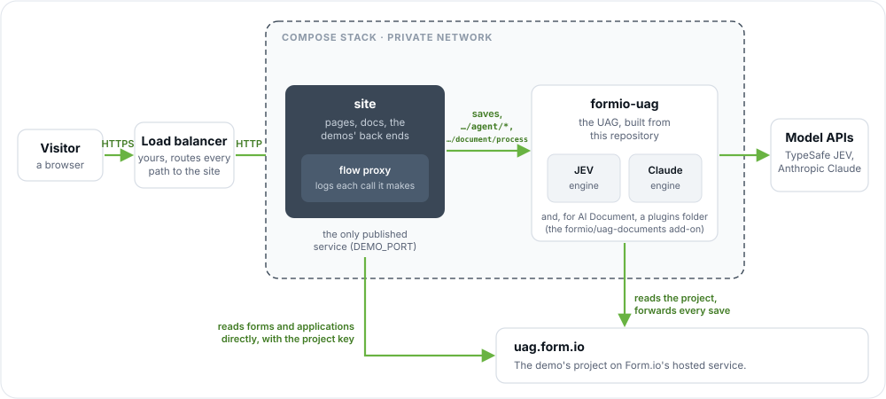

# The UAG demo site

<sub>[Form.io UAG](../README.md) &rsaquo; this page</sub>

The marketing and demo site for the Form.io Universal Agent Gateway, published at **[ai.form.io](https://ai.form.io)**:

- **Product** (`/`) and **Getting Started** (`/getting-started`): what the UAG is, and how to run it yourself.
- **Examples** (`/examples`): four live demos, each with a flow log beside it showing every call the page makes to the UAG.
  - **Conversation Forms** (`/examples/conversation`): a chat whose questions come entirely from a form.
  - **Agentic Workflow** (`/examples/workflow`): a college application reviewed by two chained agents, with no human in the loop.
  - **Agentic Formflow** (`/examples/formflow`): a claims wizard that chooses its own pages and fills itself in from a description.
  - **AI Document** (`/examples/documents`): a lease review whose AI Document components copy an uploaded lease's key clauses word for word into a field, check the copy, and summarize the lease. It needs the AI Document module and the document plugins in the UAG's plugins folder: in Docker, the `formio/uag-documents:1` add-on brings them, run beside `formio/uag` with its volume mounted at `/app/plugins/documents`; with `yarn demo:local`, set `UAG_PLUGINS` to a plugins file that lists them. Without them, the demo answers that its process is not installed.
- **Developers** (`/developers`): the technical documentation, from how the UAG works to the engine SDK.
- **Contact Us** (`/contact`): the hosted Form.io contact form.

## How it works

The site is **static files**, and the demos are what any application embedding the UAG would write: the pages load `@formio/uag-js` from the UAG (`<script src="{UAG}/uag-js/uag.use.js">`), load their forms from the demo's Form.io project, and call the UAG straight from the browser with a Form.io user token. There is no server of the site's own.



| Part | What it is |
|---|---|
| The site | `yarn demo:build` renders every page and doc (`views/`, `content/developers/`) and copies the assets and demo apps (`public/`) into `dist/`. In production it is an S3 bucket behind CloudFront ([`deploy/site.yml`](./deploy/site.yml)). |
| The project | The demo's project on Form.io's hosted service, **`https://uag.form.io`**, built from [`module/project.json`](./module/project.json): the demos' forms, and the `guest` role, resource and register form. |
| The UAG | One service, published at its own host name (`uag.ai.form.io`), with the JEV and Claude engines inside it ([`docker-compose.yml`](./docker-compose.yml)). A hosted project needs no license. |

**Guests.** A visitor who clicks **Start the live demo** is registered as a guest of the project ([`public/js/guest.js`](./public/js/guest.js)): the page posts generated credentials to the project's `guest/register` form through the UAG, which forwards them to Form.io as it forwards any save; the form's Save, Role Assignment and Login actions create a `guest` user and answer with its token. The page keeps only the token, in `localStorage`, until it expires, and gives it to formio.js (`Formio.setToken`), exactly as an application gives it its signed-in user's token. Nothing about guests is in the UAG: it forwards a registration like any other submission, and then sees an ordinary Form.io user, with that user's permissions.

**What a guest may do.** Create its own submissions of the demos' forms, and read and update its own applications (the workflow reads back the agents' results, and the "Agent: Run task" actions save them as the guest). It cannot read anyone else's submissions, or any guest. No demo form opens to anonymous visitors (`uagAnonymous` is off everywhere), so an Agent API call without a token is refused.

**The workflow's agents.** The page saves each application through the UAG, and the form's "Agent: Run task" actions run the admissions and finance tasks there, after the save, so nothing calls in from Form.io. The page reads the application back as its owner until both tasks have saved their results.

**The flow log.** Beside each demo, [`public/js/flow-log.js`](./public/js/flow-log.js) records the calls the page itself makes to the UAG and the project (it wraps `fetch`, which formio.js and `@formio/uag-js` use), with each response's status and time, and for Agent API calls which engines answered, how fast and with how many tokens. Passwords and tokens are replaced with `[redacted]` before anything is shown, and bodies are cut to 4 KB. It sends nothing anywhere. The UAG's own calls to Form.io and to the engines are not shown: the page cannot see them.

## Hosting

**The UAG.** From this folder, with `.env` filled in from [`.env.example`](./.env.example):

```bash
docker compose up -d --build
```

Or, with released images and every setting written in the file, [`deploy/docker-compose.yml`](./deploy/docker-compose.yml), which also runs the AI Document add-on. Put your load balancer in front of it for its host name (TLS ends there), and set `DEMO_SITE_ORIGIN` (`CORS`) to the site's origin, `https://ai.form.io`: the UAG answers browsers from that origin only. [`uag-module/`](./uag-module/index.js) gives every guest per-minute limits on chat, extraction and document processing, and all guests together a limit on Claude calls, per UAG instance (`DEMO_RATE_LIMITS` replaces them).

**The site.** [`deploy/site.yml`](./deploy/site.yml) is a CloudFormation stack, deployed once in `us-east-1`: a private S3 bucket that only its CloudFront distribution reads, a CloudFront function that serves `<path>/index.html` for `<path>`, the site's `404.html` for anything else, a response headers policy with the Content-Security-Policy (which allows the UAG's origin, a stack parameter), and a deploy role for GitHub Actions.

```bash
aws cloudformation deploy --region us-east-1 --stack-name uag-demo-site \
  --template-file demo/deploy/site.yml --capabilities CAPABILITY_NAMED_IAM \
  --parameter-overrides DomainName=ai.form.io CertificateArn=<an ACM certificate in us-east-1> \
    UagOrigin=https://uag.ai.form.io
```

Point the domain at the stack's `DistributionDomainName` output. Then create a GitHub environment, `demo-site`, with the variables `DEMO_UAG_URL` (`https://uag.ai.form.io`), `DEMO_SITE_BUCKET`, `DEMO_SITE_DISTRIBUTION_ID` and `DEMO_SITE_ROLE_ARN` (the stack's outputs). [`.github/workflows/site.yml`](../.github/workflows/site.yml) then builds and publishes the site on every version tag, and when run by hand: scripts and styles first (kept for good: every page names them with `?v=`), then the pages (revalidated on every load), then removes what the build no longer has, and invalidates the distribution. The deploy role trusts that environment only, through GitHub's OIDC; no AWS key is stored.

**The project.** Import `module/project.json` into it before the first deploy: the portal's Import Template, or `FORMIO_PROJECT_URL=... PROJECT_KEY=... yarn workspace @formio/uag-demo setup`, which imports it again when it changes (an import updates the forms in place, keeping their submissions, and replaces their actions). Keep the forms' paths and keys, such as `serviceRequest`, `application`, `claim` and `guestRegister`, and their actions: the pages address them by name. Set the project's token expiry to the length of a visit (two hours is plenty): a guest's token lasts that long.

**Retention.** [`.github/workflows/demo-retention.yml`](../.github/workflows/demo-retention.yml) runs [`scripts/retention.mjs`](./scripts/retention.mjs) every hour: it deletes the demo forms' submissions and the guests once they are a day old, with the project's API key (the secret `DEMO_PROJECT_KEY`). It runs only when the repository variable `DEMO_RETENTION_ENABLED` is `true`. It logs counts, never a submission.

**Spend.** Registration is open (there is no human check yet), so set a spend limit with the model provider before the site is public. The rate limits above bound each guest and all guests together, and retention removes guests after a day. A human check can be added later without changing the pages' embed code: AWS WAF in front of the site and the UAG (rate-based rules, Bot Control), or Form.io's own CAPTCHA component on the `guest/register` form, which Form.io enforces server-side.

## Settings

The build reads its settings from the environment ([`lib/config.mjs`](./lib/config.mjs)), and from `demo/.env.local` when that file exists and `NODE_ENV` is not `production`. Everything the build reads ends up in the pages, so none of it may be a secret: the build fails if the value of any environment variable whose name says it is a secret (`KEY`, `SECRET`, `PASS`, `LICENSE`, `TOKEN`) appears in its output.

| Variable | Default | Purpose |
|---|---|---|
| `DEMO_UAG_URL` | `http://localhost:3200`; required in production | The UAG the pages call. |
| `FORMIO_PROJECT_URL` | `https://uag.form.io` | The project the forms load from. |
| `DEMO_UAG_PROJECT_PATH` | `/<project name>` | Where the UAG serves the project's forms: under the project's name (its subdomain, or the last segment of a self-hosted project's URL), or at the UAG's root (`""`) for Form.io Open Source. |
| `FORMIO_BASE_URL` | Derived from the project URL | formio.js's base URL. |
| `DEMO_DOMAIN`, `DEMO_PUBLIC_URL` | `ai.form.io`, `https://<DEMO_DOMAIN>` | The site's own address, for canonical links and social cards. |
| `DEMO_OUT` | `dist` | Where the build is written. |
| `DEMO_ASSET_VERSION` | The release's version | Added to the URLs of scripts and styles (`?v=`). The site workflow adds the commit. |
| `CONTACT_FORM_URL` | `https://formio.form.io/contact` | The hosted form the Contact Us page renders. |
| `FORMIO_JS_VERSION` | `5.6.1` | The formio.js the demo apps load. |

The UAG's settings are in [`.env.example`](./.env.example).

## Working on it

Run on your own machine, the examples say when they cannot run: a UAG that cannot run Agentic Formflow (no license that includes the UAG, and not on a hosted project) refuses the formflow and AI Document demos' calls, and the page says they are not supported, with what a local run needs; the workflow says so if no agent answers within 45 seconds. Conversation forms run everywhere. The deployed site (`NODE_ENV=production`) never shows that notice: there, a UAG that does not answer is an outage, and the demos say so.

### Against your own project (`yarn demo:local`)

The quickest way to run every demo on your machine: your own project on Form.io's hosted service (a free one from [portal.form.io](https://portal.form.io) will do, or a stage of one). No Docker, and no UAG license: a hosted project runs Agentic Formflow under Form.io's license.

**You need:** Node.js 22 or later, Yarn (`corepack enable`), an API key of the project (the project's **Settings → API Keys**), a Claude API key, and a TypeSafe API key (for JEV, the decision engine).

```bash
git clone https://github.com/formio/uag.git && cd uag
yarn install && yarn build
cp demo/local.env.example demo/.env.local      # then fill it in (below)
yarn demo:local                                # http://localhost:8080
```

In `demo/.env.local` (git ignores it):

| Setting | Value |
|---|---|
| `FORMIO_PROJECT_URL` | Your project, `https://<name>.form.io`. Not `https://uag.form.io`, the deployed demo's own project. |
| `PROJECT_KEY` | The project's API key. The UAG uses it; the site never sees it. |
| `CLAUDE_API_KEY`, `TYPESAFE_API_KEY` | Your model keys. |
| `DEMO_TEMPLATE_SYNC` | Leave empty the first time, so the demo's forms are imported. Set `off` afterwards, or on a project others already set up and share. |

`yarn demo:local` then:

1. Imports the demo's roles, forms and actions (`module/project.json`) into the project. An empty project is fine; forms it already has are updated in place.
2. Starts the UAG from `lib/` on the project, with JEV and Claude in-process, on `UAG_PORT` (3200), allowing the site's origin.
3. Builds the site for that UAG and project and serves it on `DEMO_PORT` (8080), rebuilding it when its pages, docs or scripts change, and prints what it found:

```
[demo:local] The demo is running at http://localhost:8080
[demo:local] Project:  https://<name>.form.io
[demo:local] UAG:      http://localhost:3200 (enterprise edition; Agentic Formflow enabled, hosted)
```

Ctrl+C stops everything. If a port is taken, it says which one and which setting moves it. The AI Document demo also needs `UAG_PLUGINS` (see above).

### The whole demo, self-hosted (`yarn demo:start <port>`)

One command runs every demo against Form.io Enterprise on your machine, with its portal, real engines (JEV and Claude), and a portal stage connected to the UAG, so "Agent: Run task" opens in the portal and its runs appear in Action Logs.

**You need:** Docker, Node.js 22 or later, Yarn (`corepack enable`), and in the root `.env` (git ignores it):

| Setting | Value |
|---|---|
| `LICENSE_KEY` | A Form.io Enterprise license. The UAG uses it too, so it should include the UAG and allow the endpoint `formio.e2e.test`: inside the stack, the UAG reaches Form.io's API server by that name. |
| `UAG_LICENSE` | Optional: the UAG's own license, when `LICENSE_KEY` does not include the UAG or allow that endpoint. |
| `CLAUDE_API_KEY`, `TYPESAFE_API_KEY` | Your model keys. |

The deployment's own settings (`ADMIN_EMAIL`, `ADMIN_PASS`, `FORMIO_ADMIN_KEY`, `PROJECT_KEY`, `DB_SECRET`, `FORMIO_JWT_SECRET`, `UAG_JWT_SECRET`, `PORTAL_SECRET`) are taken from the root `.env` when set there, and are otherwise random for that start. They are read from the file, not loaded into the environment, so a variable set in your shell with the same name takes precedence.

```bash
git clone https://github.com/formio/uag.git && cd uag
yarn install
npx playwright install chromium   # once: connecting the portal stage drives the portal in a browser
yarn demo:start 3430              # the port to start at
```

The port is the first of three, on 127.0.0.1:

| Port | What |
|---|---|
| `3430` | The demo site. |
| `3431` | Form.io Enterprise and its portal, where the site's pages load their forms. |
| `3432` | The UAG, built from this checkout, which the site's pages call. |

It builds the UAG's image from this checkout (the first start takes several minutes), starts MongoDB and Form.io, runs the setup job ([`scripts/setup.mjs`](./scripts/setup.mjs)), which creates the `UAG Demo` project from `module/project.json`, starts the UAG on it, builds the site for them and serves it, and last creates a stage, **UAG Gateway**, connected to the UAG. When it is up it prints the URLs and the portal's administrator sign-in. Every start is fresh: Ctrl+C stops the stack and removes its data. Give another port to run a second copy beside the first; each runs as its own Compose project (`uag-demo-<port>`).

`yarn demo:start` with no port builds and serves the site alone, from `demo/.env.local`, against whatever UAG `DEMO_UAG_URL` names, rebuilding on every change.

### Open Source, with scripted engines (`yarn demo:dev`)

```bash
yarn install && yarn build      # the UAG, from lib/
yarn demo:dev                   # http://127.0.0.1:3420; Ctrl+C stops it and removes the containers
```

It runs Form.io Open Source and MongoDB in Docker, the UAG from `lib/`, the engine server with the e2e suite's scripted engines (instant, keyword-driven answers for the workflow and the claims wizard), and the site built for them, as the e2e suites do ([`scripts/dev.mjs`](./scripts/dev.mjs)). The chat is answered by the scripted agent engine, which reads `Label: value` pairs, such as `Full Name: Ada Lovelace; Category: Billing`. The workflow and formflow demos are Agentic Formflow, so they need a license that includes the UAG, `LICENSE_KEY` (or `E2E_UAG_LICENSE`) in the root `.env`. The site is rebuilt when its sources change; reload to see it.

### The other layouts

`docker-compose.split.yml` moves the engines to the engine server (`packages/engine-server`, `uag-engines`), so the UAG holds no model keys; it needs `ENGINE_SERVER_KEY`. `docker-compose.enterprise.yml` holds the project on Form.io Enterprise in the stack, created by the setup job; it needs `LICENSE_KEY`, and the settings marked "self-hosted" in `.env.example`. With it, browsers must reach Form.io too (the pages load their forms there), so publish it as well and build the site with `FORMIO_PROJECT_URL` set to its public URL.

```bash
docker compose -f docker-compose.yml -f docker-compose.split.yml up -d --build
```

### What is where

| Path | What |
|---|---|
| `lib/` | What the build renders with: `pages.mjs` (the pages, from `views/`), `docs.mjs` and `diagrams.mjs` (the docs, from `content/developers/`), and `config.mjs` (the build's settings and the Content-Security-Policy). |
| `scripts/` | `build.mjs` (the site, into `dist/`), `serve.mjs` (serves `dist/` as CloudFront does), `setup.mjs` (imports the template), `retention.mjs`, and the local stacks: `local.mjs`, `start.mjs`, `dev.mjs`. |
| `public/` | Styles, scripts, images, and the four demo apps under `public/apps/`. `js/guest.js` signs visitors in, `js/flow-log.js` records the page's calls, and `js/demo-app.js` points formio.js at the project. |
| `module/` | The demo project (`project.json`) and the sample applicants. |
| `uag-module/` | The UAG module the demo's UAG runs with: its rate limits. |
| `deploy/` | `site.yml` (CloudFormation for S3 and CloudFront) and `docker-compose.yml` (the UAG, from released images). |
| `samples/` | Things to start your own deployment from: the [custom module](./samples/custom-module) (Claude Desktop) and [engine setups](./samples/engines). |
| `recordings/` | The Playwright scripts that record the documentation's demo GIFs (`yarn demo:record`), with the storyboard each one follows. See [recordings](./recordings/README.md). |
| `test/` | Unit tests, run by `yarn test` at the root. The e2e suites are `test/e2e/layer1.demo-*` and `layer3.demo-stack` at the root. |

The docs are Markdown; see [`content/developers/README.md`](./content/developers/README.md) for the format.
