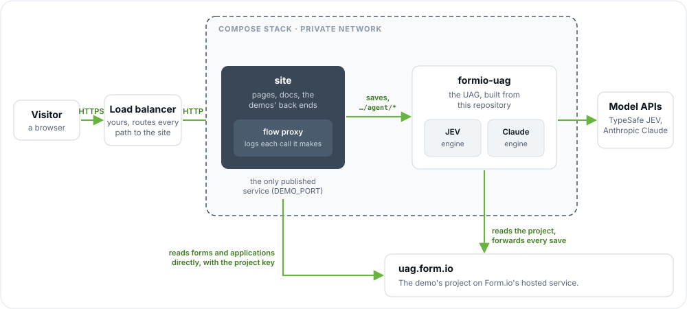

# The UAG demo site

<sub>[Form.io UAG](../README.md) &rsaquo; this page</sub>

The marketing and demo site for the Form.io Universal Agent Gateway, published at **[ai.form.io](https://ai.form.io)**:

- **Product** (`/`) and **Getting Started** (`/getting-started`): what the UAG is, and how to run it yourself.
- **Examples** (`/examples`): three live demos, each with a flow viewer beside it showing every call the agents make.
  - **Conversation Forms** (`/examples/conversation`): a chat whose questions come entirely from a form.
  - **Agentic Workflow** (`/examples/workflow`): a college application reviewed by two chained agents, with no human in the loop.
  - **Agentic Formflow** (`/examples/formflow`): a claims wizard that chooses its own pages and fills itself in from a description.
- **Developers** (`/developers`): the technical documentation, from how the UAG works to the engine SDK.
- **Contact Us** (`/contact`): the hosted Form.io contact form.

Everything runs as one Docker Compose stack of two services, on the demo's project on Form.io's hosted service, **`https://uag.form.io`**. Only the site is published; the UAG stays on the stack's private network, which is the deployment the site itself recommends. A hosted project needs no license.



| Service | What it is |
|---|---|
| `site` | This folder's server (`server/`): the pages, the docs, the demos' back ends, and the flow viewer. It runs the flow proxy (`flow/proxy.mjs`), a logging reverse proxy, in front of the UAG inside it, so every call a demo makes can be shown to the visitor who made it. Plain HTTP on `DEMO_PORT`. |
| `formio-uag` | The UAG, built from this repository, with the JEV and Claude engines and their keys inside it. |

**The project's forms.** The stack uses the forms already in the project; it does not create or change them. `module/project.json` is their template: import it into a new project (the portal's Import Template, or `node server/setup.mjs` with `FORMIO_PROJECT_URL` and `PROJECT_KEY`) before the first start. Keep the forms' paths and keys, such as `serviceRequest`, `application` and `claim`, and their "Agent: Run task" actions: the pages address them by name.

**The engines on their own server.** `docker-compose.split.yml` adds the engine server (`packages/engine-server`, `uag-engines`) with JEV and Claude and their keys, so the UAG holds no model keys, and runs the flow proxy as its own service (`uag-flow`) in front of both, so the flow viewer also shows what the UAG asked each engine and the engines' research calls. It needs `ENGINE_SERVER_KEY` and `FLOW_KEY` as well:

```bash
docker compose -f docker-compose.yml -f docker-compose.split.yml up -d --build
```

**The workflow's agents.** The site saves each application through the UAG, and the form's "Agent: Run task" actions run the admissions and finance tasks there, after the save, so nothing calls in from Form.io. Each run carries the visitor's request id, so the flow viewer shows it.

**Self-hosted instead.** `docker-compose.enterprise.yml` adds Form.io Enterprise and MongoDB to the stack and holds the project there, with a one-shot setup job (`server/setup.mjs`) that creates the project from `module/project.json` (or imports it again into one that exists) and installs `PROJECT_KEY`. That needs Form.io's `LICENSE_KEY`, which the UAG reads too, so it must include the UAG and allow `api-server:3000` (or add a `UAG_LICENSE`, deprecated, that does), and the settings marked "self-hosted" in `.env.example`:

```bash
docker compose -f docker-compose.yml -f docker-compose.enterprise.yml up -d --build
```

## Deploying it

```bash
cd demo
cp .env.example .env        # fill in every value marked "required"
docker compose up -d --build
```

Then point your load balancer or reverse proxy at `DEMO_BIND:DEMO_PORT` (127.0.0.1:8080 by default; set `DEMO_BIND` to the private address the load balancer reaches) for `ai.form.io`, terminating TLS there. If your load balancer adds more than one `X-Forwarded-For` entry (some cloud load balancers and CDNs do), raise `TRUST_PROXY` to match, or every visitor shares one rate limit. The site sends `Strict-Transport-Security` when its public URL is `https`, reads visitor IPs from `X-Forwarded-For` through `TRUST_PROXY` hops, and serves its live streams (`/api/flow/stream`, `/api/formflow/agent/extract`) as server-sent events: turn off response buffering for those paths, and allow long-lived responses (a few minutes).

The images build from this repository (`docker compose build`). To deploy released images instead, set `UAG_IMAGE`, `ENGINES_IMAGE` and `DEMO_IMAGE` in `.env` and run `docker compose pull`.

`PROJECT_KEY` is an API key of `https://uag.form.io`, made in the project's settings (API Keys). To run the stack on another hosted project, set `FORMIO_PROJECT_URL` and its key; the project's name is read from its subdomain (`FORMIO_PROJECT_NAME` overrides it).

## Changing the domain

The domain is one setting. Set `DEMO_DOMAIN` in `.env` to the new name (and `DEMO_PUBLIC_URL` only if it is not `https://<DEMO_DOMAIN>`), restart the site, and move the load balancer. Canonical links, social cards and cookies follow it. Nothing inside the stack names the public domain: every service reaches the others by their Compose names.

The repository's own docs link to `ai.form.io` as the place to see the demos; search for it when the domain changes for good.

## Keeping the demos safe to leave public

The demos call real models on Form.io's keys and hold what visitors type, so the site:

- **Checks visitors are human** with Cloudflare Turnstile. It is required in production (`NODE_ENV=production`): the site does not start without `TURNSTILE_SITE_KEY` and `TURNSTILE_SECRET_KEY` unless `DEMO_REQUIRE_TURNSTILE=false`. One challenge unlocks the demos for `TURNSTILE_VALID_MINUTES` (120).
- **Rate limits** each operation per client network (an IPv4 address, or an IPv6 /64) and then per visitor (`DEMO_LIMITS`, JSON; see `server/config.mjs` for the defaults). A network may also start only `DEMO_SESSIONS_PER_NETWORK` (default 300, so offices and campuses behind one address are not shut out) new visitor sessions in ten minutes, and hold `DEMO_STREAMS_PER_NETWORK` (default 10) flow views open.
- **Caps the day's spend** at `DEMO_DAILY_BUDGET` units across all visitors, and `DEMO_DAILY_NETWORK_BUDGET` per network. A chat turn or an extraction costs a unit up front (an application 2; `DEMO_COSTS` changes them), and a chat turn pays one more per `DEMO_TOKENS_PER_UNIT` model tokens it used, from the engine `usage` the UAG reports with each turn. A conversation may take `CHAT_MAX_TURNS` (30) turns before it must start over (starting over is rate-limited like a turn), with messages of at most `CHAT_MAX_MESSAGE_LENGTH` (2000) characters, and the UAG bounds each turn's transcript itself (`agentApi.chat`). Requests are validated before they are charged. The count is kept in the `demo-state` volume, so a restart does not reset it. Once it is spent the demos say so until midnight UTC; the rest of the site keeps working. Set a spend limit on the model provider's side too.
- **Keeps visitors apart.** A visitor is a signed cookie (`DEMO_SECRET`; `__Host-` prefixed over HTTPS), started only by the demos' API. They can read only the applications they submitted, and the flow viewer shows them only their own runs: every call the site makes for them carries an `X-Request-Id` naming their session, which the UAG passes on to the Run task runs a save starts and to the engine server, and the engine server to its research calls. Token exchanges are redacted from the viewer, and so are the private services' addresses.
- **Narrows the chat.** The page embeds one form, `CHAT_FORM` (`serviceRequest`), with `Formio.createChat`, and the site's `/api/conversation/uag` routes stand in for the UAG for that form only: the form, its `agent/chat` turns and its save, relayed with the project key behind the guard above. The UAG's chat only ever sets fields a person may enter on that form, and never submits; the page submits after the visitor confirms.
- **Deletes what visitors submit** after `DEMO_RETENTION_HOURS` (24), and never writes request bodies to its logs.
- **Fixes the task server-side.** The browser cannot choose which form or task the demo's key is used for, or pre-fill the agents' fields; descriptions are capped at `DEMO_MAX_INPUT_LENGTH` (8000) characters, and the claim upload is read only after the guard lets it in.
- **Publishes only the site, and only on `DEMO_BIND`** (127.0.0.1 by default). Point your load balancer at it on a private address: the site trusts the `X-Forwarded-For` of whatever connects to it (`TRUST_PROXY` hops), so the port must not be reachable around the load balancer. With the Enterprise overlay, MongoDB is on an internal network only Form.io can reach.

Sessions and rate-limit counters are in the site's memory (bounded), so run one instance of `site`.

## Settings

The common ones are in [`.env.example`](./.env.example), and every one, with its default, is read in [`server/config.mjs`](./server/config.mjs). Under Compose, a variable reaches the site only if the `site` service's `environment` passes it. The ones you are most likely to change:

| Variable | Default | Purpose |
|---|---|---|
| `DEMO_DOMAIN` | `ai.form.io` | The domain the site is served at. |
| `DEMO_PORT`, `DEMO_BIND` | `8080`, `127.0.0.1` | The host port the site listens on, and the address it is bound to. |
| `CONTACT_FORM_URL` | `https://formio.form.io/contact` | The hosted form the Contact Us page renders. Point it at the form on `crm.form.io` once it is there. |
| `CLAUDE_MODEL` | `claude-sonnet-5-5` | The model the Claude engine uses, for values and for the chat. |
| `CHAT_FORM` | `serviceRequest` | The form the Conversation Forms demo embeds as a chat. The page addresses it by its path, `service-request`, so change both together. |
| `CHAT_MAX_TURNS` | `30` | Turns one conversation may take before the visitor must start over. |
| `CHAT_MAX_MESSAGE_LENGTH` | `2000` | The longest message the demo relays, in characters. Keep it within the UAG's `agentApi.chat.maxMessageLength`. |
| `PROJECT_TTL` | `300` | Seconds between the UAG's re-reads of the project. |
| `DEMO_TEMPLATE_SYNC` | `import` | With `docker-compose.enterprise.yml`, `off` stops the setup job updating an existing project's forms from `module/project.json`. |

## Working on it

Run on your own machine, the examples say whether they can run: with no UAG to talk to, or one that cannot run Agentic Formflow (no license that includes the UAG, and not on a hosted project), they show a notice that a license is needed to run them locally, and the workflow and formflow demos say they are not supported. The deployed site (`NODE_ENV=production`) never shows it: there, a UAG that does not answer is an outage, and the demos say so themselves.

### The whole demo on your machine, self-hosted (`yarn demo:start <port>`)

One command runs every demo against Form.io Enterprise on your machine, with its portal, real engines (JEV and Claude), and a portal stage connected to the UAG, so "Agent: Run task" opens in the portal and its runs appear in Action Logs.

**You need:** Docker, Node.js 22 or later, Yarn (`corepack enable`), and in the root `.env` (git ignores it):

| Setting | Value |
|---|---|
| `LICENSE_KEY` | A Form.io Enterprise license. The UAG uses it too, so it should include the UAG and allow the endpoint `formio.e2e.test`: inside the stack, the UAG reaches Form.io's API server by that name. |
| `UAG_LICENSE` | Optional: the UAG's own license, when `LICENSE_KEY` does not include the UAG or allow that endpoint. |
| `CLAUDE_API_KEY`, `TYPESAFE_API_KEY` | Your model keys. |

The deployment's own settings are optional. Each is taken from the root `.env` when set there, by the name the deployment uses ([`demo/.env.example`](./.env.example)), and is otherwise random for that start:

| Setting | What |
|---|---|
| `ADMIN_EMAIL`, `ADMIN_PASS` | The portal administrator's sign-in. Default: `admin@example.com`, with a random password. Both are printed when the demo is up. |
| `PROJECT_KEY` | The demo project's API key. |
| `DB_SECRET`, `FORMIO_JWT_SECRET` | Form.io's database and token secrets. |
| `UAG_JWT_SECRET`, `PORTAL_SECRET` | The UAG's token secret, and the secret the portal stage is connected with. |
| `ENGINE_SERVER_KEY`, `FLOW_KEY`, `DEMO_SECRET` | The engine server's key, the flow viewer's key, and the site's session secret. |

The settings are read from the file, not loaded into the environment, so a variable set in your shell with the same name takes precedence.

```bash
git clone https://github.com/formio/uag.git && cd uag
yarn install
npx playwright install chromium   # once: connecting the portal stage drives the portal in a browser
yarn demo:start 3430              # the port to start at
```

The port is the first of three, on 127.0.0.1:

| Port | What |
|---|---|
| `3430` | The demo site, with all three examples: `/examples/conversation`, `/examples/workflow`, `/examples/formflow`. |
| `3431` | Form.io Enterprise and its portal. |
| `3432` | The UAG, built from this checkout. |

Give another port to run a second copy beside the first; each runs as its own Compose project (`uag-demo-<port>`).

It builds the images from this checkout (the first start takes several minutes), starts MongoDB and Form.io, and runs the setup job, which creates the `UAG Demo` project and imports the demo's roles, forms and actions into it (`module/project.json`): `serviceRequest`, `application`, `sum` and `claim`, with their "Agent: Run task" actions. Then it starts the UAG on that project, with its own database on the same MongoDB, the engine server, the flow proxy and the site. Last, it creates a stage, **UAG Gateway**, and connects it to the UAG. When it is up it prints the URLs and the portal's administrator sign-in:

```
The UAG demo is running:

  Demo site            http://127.0.0.1:3430
    Conversation forms http://127.0.0.1:3430/examples/conversation
    Agentic Workflow   http://127.0.0.1:3430/examples/workflow
    Agentic Formflow   http://127.0.0.1:3430/examples/formflow
  Form.io portal       http://127.0.0.1:3431
    Sign in as         admin@example.com
    Password           <random>   (generated; set ADMIN_PASS in .env to choose it)
    Stage "UAG Gateway" of the "UAG Demo" project is connected to the UAG.
  UAG                  http://127.0.0.1:3432
```

Every start is fresh: Ctrl+C stops the stack and removes its data, and the settings you did not set are new each time (the output lists them). If the UAG's license does not allow `formio.e2e.test`, it says that Agentic Formflow is off, and the workflow and formflow demos will not run. If connecting the stage fails (Chromium not installed, for one), the demo still runs, without it. `yarn demo:start` with no port still runs the site alone (see [Against a UAG you run](#against-a-uag-you-run)).

### Run it against your own project

The quickest way to run every demo on your machine: your own project on Form.io's hosted service (a free one from [portal.form.io](https://portal.form.io) will do, or a stage of one), and one command. No Docker, and no UAG license: a hosted project runs Agentic Formflow under Form.io's license.

**You need:** Node.js 22 or later, Yarn (`corepack enable`), an API key of the project (the project's **Settings → API Keys**), a Claude API key, and a TypeSafe API key (for JEV, the decision engine).

```bash
git clone https://github.com/formio/uag.git && cd uag
yarn install && yarn build
cp demo/local.env.example demo/.env.local      # then fill it in (below)
yarn demo:local                                # http://localhost:8080
```

In `demo/.env.local` (git ignores it):

| Setting | Value |
|---|---|
| `FORMIO_PROJECT_URL` | Your project, `https://<name>.form.io`. Not `https://uag.form.io`, the deployed demo's own project. |
| `PROJECT_KEY` | The project's API key. |
| `CLAUDE_API_KEY`, `TYPESAFE_API_KEY` | Your model keys. |
| `DEMO_TEMPLATE_SYNC` | Leave empty the first time, so the demo's forms are imported. Set `off` afterwards, or on a project others already set up and share. |

`yarn demo:local` then:

1. Imports the demo's forms and actions (`module/project.json`) into the project: `serviceRequest`, `application`, `sum` and `claim`. An empty project is fine; forms it already has are updated in place.
2. Starts the UAG from `lib/` on the project, with JEV and Claude in-process, on `UAG_PORT` (3200).
3. Starts the flow proxy, for the flow viewer, on `FLOW_PORT` (3250).
4. Starts the site on `DEMO_PORT` (8080), and prints what it found:

```
[demo:local] The demo is running at http://localhost:8080
[demo:local] Project:  https://<name>.form.io
[demo:local] UAG:      http://localhost:3200 (enterprise edition; Agentic Formflow enabled, hosted)
```

Ctrl+C stops everything. If a port is taken, it says which one and which setting moves it.

**What works.** All three demos work as soon as it is up: the Agentic Workflow's agents run in the local UAG, on the applications the site saves through it.

### Against a UAG you run

Run a UAG on your machine, connected to `https://uag.form.io` (or any hosted project, or another project with a `LICENSE_KEY`), and then the site alone against it. In the UAG's `.env`, at the repository root:

```bash
PORT=3200
PROJECT=https://uag.form.io
PROJECT_KEY=<an API key of the project>
JWT_SECRET=<openssl rand -hex 32>
# The engines the deployed stack runs: JEV decides, Claude fills in values.
UAG_ENGINES=jev,claude
TYPESAFE_API_KEY=<your key>
CLAUDE_API_KEY=<your key>
```

Then the site's, in `demo/.env.local` (read by `yarn demo:start`):

```bash
FORMIO_PROJECT_URL=https://uag.form.io
PROJECT_KEY=<the same key>
UAG_URL=http://localhost:3200
DEMO_PUBLIC_URL=http://localhost:8080
CLAUDE_API_KEY=<your key>
```

```bash
yarn build && yarn start        # the UAG, on :3200
yarn demo:start                 # the site, on http://localhost:8080
```

The UAG reports the hosted project (`reason: "hosted"`), so every demo runs and no notice is shown. There is no flow proxy in this setup, so the flow viewer is off. The site saves applications through your UAG, so the workflow's Run task actions run there.

### The whole stack

Run the whole site locally:

```bash
yarn install && yarn build      # the UAG, from lib/
yarn demo:dev                   # http://127.0.0.1:3420; Ctrl+C stops it and removes the containers
```

It runs Form.io Open Source and MongoDB in Docker, the UAG from `lib/`, the engine server with the e2e suite's scripted engines (instant, keyword-driven answers for the workflow and the claims wizard), the flow proxy and the site, as the e2e suites do ([`scripts/dev.mjs`](./scripts/dev.mjs)). The chat (the UAG's `agent/chat`) is answered by the scripted agent engine, which reads `Label: value` pairs, such as `Full Name: Ada Lovelace; Category: Billing`. The workflow and formflow demos are Agentic Formflow, so they need a license that includes the UAG, `LICENSE_KEY` (or `E2E_UAG_LICENSE`) in the root `.env`; without one the examples show the notice, and those two demos "Not supported without a license or SaaS project", as they do against any Open Source server or unlicensed UAG. Pages and docs are re-read on every request, so edits show on reload; restart it after changing server code.

| Path | What |
|---|---|
| `server/` | The site: `index.mjs` (routes), `pages.mjs` (the pages, from `views/`), `docs.mjs` and `diagrams.mjs` (the docs, from `content/developers/`), one module per demo, and the guard, sessions and flow viewer. |
| `public/` | Styles, scripts, images, and the three demo apps under `public/apps/`. |
| `flow/proxy.mjs` | The flow proxy. |
| `module/` | The demo project (`project.json`) and the sample applicants. |
| `samples/` | Things to start your own deployment from: the [custom module](./samples/custom-module) (Claude Desktop) and [engine setups](./samples/engines). |
| `recordings/` | The Playwright scripts that record the documentation's demo GIFs (`yarn demo:record`), with the storyboard each one follows. See [recordings](./recordings/README.md). |
| `test/` | Unit tests, run by `yarn test` at the root. The e2e suites are `test/e2e/layer1.demo-*` and `layer3.demo-stack` at the root. |

The docs are Markdown; see [`content/developers/README.md`](./content/developers/README.md) for the format.
